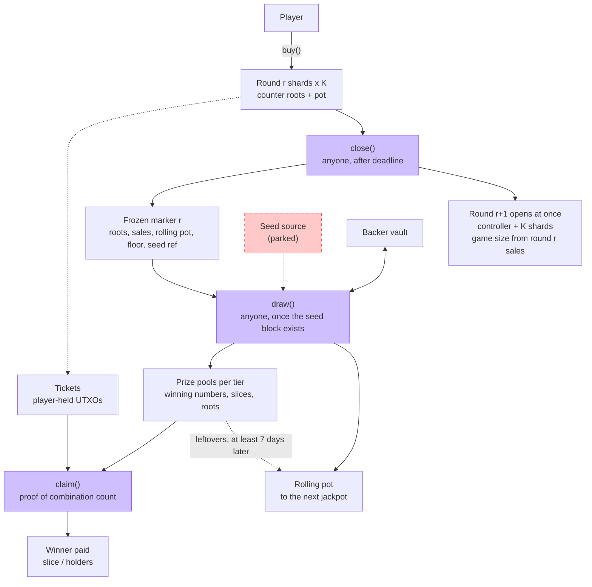

# Kaspa L1 Lottery — Protocol Design Draft v0.4

**Date:** 8 October 2026

**Status:** Proposed design; not implemented, benchmarked or audited. Section 2 lists what is established, proposed and open.

**Purpose:** A KAS-only lottery on Kaspa L1 (Toccata covenants) in which players buy tickets and claim prizes, a single public function closes each round and opens the next, and every lottery rule is enforced by L1 — with no keeper bots and no off-chain lottery logic.

**Revision note:** v0.4 supersedes all earlier drafts. It is a claim-based design modelled on MegaPot: per-combination counters recorded at purchase, prizes set by a fixed per-combination formula, instant claims, and backers who underwrite only the jackpot floor and are settled at the draw. Randomness remains parked (section 11).

# 1. Goal and scope

## 1.1 The goal

A player buys a ticket and, if it wins, claims. That is all a player ever does. The protocol has public functions that anyone may call; the most important one closes the round, opens the next round immediately and leads to the draw. All lottery rules — ticket validity, matching, prize amounts, duplicate sharing, backer settlement, rollover — are computed and enforced by L1 covenants.

## 1.2 What "on L1" means on Kaspa

Kaspa L1 does not execute a function and write the result itself. Every transaction must state its outputs in advance, and covenant scripts accept or reject it. Two consequences shape this design:

-   **Someone must submit each transaction.** This is true on every blockchain; MegaPot's `runJackpot()` also needs a caller. Here every protocol function is public and needs no special key; `close()` and `draw()` pay their caller a small reward. Players themselves can call any of them.
-   **Outputs must not require off-chain lottery logic.** Every function is designed so its outputs follow directly from its inputs and fixed rules. A wallet only assembles the transaction and attaches proofs that the covenant verifies. No wallet or bot decides who won or how much anyone is paid.

The resulting requirement: **every rule and every result is enforced by L1; off-chain software only proposes transactions and cannot change any outcome.**

## 1.3 Scope

-   **In scope:** tickets, round lifecycle, the per-combination counter, prize model, game sizing, backers, claims, data retention, safety review, prototype plan.
-   **Parked:** how the seed is obtained. The design defines where the seed enters (`draw()`), not how it is made unbiased. No real-value launch until it is solved.

## 1.4 Non-negotiable properties

1. KAS is the only deposited and paid asset.
2. Every winning claim is checked on L1 against the winning numbers and the frozen counters.
3. No privileged operator, sequencer, result oracle or keeper is required.
4. Every protocol function is permissionless.
5. Ticket counts are frozen before the seed can be known (this relies on the parked seed design, section 11).
6. No administrator can change rules of a live round, redirect funds or substitute a draw. New rules require a new instance.
7. Correctness survives the disappearance of any project-operated service.

# 2. Status

| Area | Status | What closes it |
|:----------------------------|:------------------|:--------------------------------------|
| Introspection, covenant IDs, hashing, byte ops, OpMul/OpDiv, lower-bound locktime | Spec-backed [S1–S2, S8] | Available on mainnet since Toccata |
| Covenant state behind P2SH; ~30 h pruning | Confirmed [S13–S14] | Platform property; design accommodates it (section 9) |
| Four-function lifecycle (buy, close, draw, claim) | Proposed | Testnet prototype (section 13) |
| Per-combination counter in sharded Merkle trees | Proposed | Benchmark Merkle update and proof cost in SilverScript |
| Prize formula and solvency | Proposed; argued in 4.4 | Negative tests in prototype |
| Backer settlement at draw | Proposed | Prototype Stage 4 |
| Game sizing rule | Decided; parameters open | Economic modelling (4.6, 14) |
| Claim window of at least 7 days | Decided | — |
| Ticket deposit and storage mass | **Open** | Measure KIP-9 storage mass for ticket outputs |
| Shards per round (K) and `close()` size | **Open** | Benchmark |
| Native randomness | **Parked** | Section 11 |

**Pinned baseline:** rusty-kaspa v2.0.1, commit cfafeb4c093fa37a303f1b9f19c58f986b870ce3, mainnet Toccata activation at DAA 474,165,565. A later release exists; pin the production release before implementation. SilverScript is experimental and recommends testnet-10 until its v1 [S3].

# 3. How it works

## 3.1 The four functions

| Function | Who calls it | What it does |
|:--------------|:----------------|:-------------------------------------------------|
| `buy()` | Player | Records the player's combination in the round's counter, adds the ticket price to the pot, creates the player's ticket |
| `close()` | Anyone, after the round deadline | Freezes all counters and the pot of the ending round, and **opens the next round immediately** with the game size set from this round's sales |
| `draw()` | Anyone, once the seed block exists | Sets the winning numbers, computes every tier's prize slice, settles backers, decides jackpot rollover, funds prize pools |
| `claim()` | Anyone (normally the winner) | Proves a ticket's combination and its holder count, and pays the prize to the ticket's fixed payout address |

Supporting functions: `reclaim()` lets a ticket's owner take back its deposit after the round is over; backer `deposit()` and `withdraw()`; `refresh()` (7.5).

## 3.2 Round timeline

| Time | Event |
|:----------------|:-----------------------------------------|
| Round open | Players `buy()` at any time |
| Deadline T | `close()` becomes valid once round r−1 has been drawn. It freezes round r and opens round r+1 in one transaction. Sales never pause |
| After the seed block | `draw()` for round r |
| Draw + 7 days | Earliest end of the claim window: the first `draw()` after this point absorbs what is left in the round's prize pools into the rolling pot |

MegaPot uses the same two-step shape: `runJackpot()` locks the round and requests randomness, and a callback settles it. Here `close()` is the lock (and opens the next round at once), and `draw()` is the settlement.

## 3.3 Flow diagram

A rendered version of this diagram is in `flow.png`.

# 4. Game and prize model

## 4.1 The game

A ticket is 5 distinct numbers from 1..n plus a bonus number from 1..m. The game size (n, m) is fixed for a round before it opens (4.6). The total number of combinations is C = choose(n,5) × m. If m = 1 there is no bonus dimension and the bonus factor below is dropped.

A winning ticket's tier is determined by k, the number of matched main numbers, and whether the bonus matches. The number of combinations that win a tier is a constant of the game:

> W(k, bonus) = choose(5,k) × choose(n−5, 5−k) × (1 if the bonus matches, else m−1)

W does not depend on the winning numbers or on what anyone bought. For example, in a 5-of-25 game without bonus: W = 1 (5 matches), 100 (4), 1,900 (3), 11,400 (2).

## 4.2 The combination slice

Each paying tier t has a budget B_t (section 5). Every winning combination in that tier owns an equal slice:

> slice_t = floor(B_t / W_t)

All tickets holding the same winning combination share that combination's slice equally:

> prize per ticket = floor(slice_t / h), where h is the number of tickets holding that exact combination

| Situation | Result |
|:------------------------------------|:----------------------------------------|
| One person holds the jackpot combination | Whole jackpot, instantly |
| Three people hold it | Each gets one third, instantly, in any order |
| Nobody holds the jackpot combination | Known at `draw()`; the jackpot rolls over immediately (5.2) |
| Nobody holds a lower-tier winning combination | Its slice is not paid; it goes to the rolling pot after the claim window |

This is MegaPot's idea that payouts are set per possible winning combination rather than per actual winner [S11]. MegaPot gives every winner budget ÷ (W + duplicate winners), which requires tier-wide duplicate totals; this design splits per combination, which needs only each combination's own count.

## 4.3 Duplicates

h comes from the per-combination counter (section 8), which every `buy()` updates and `close()` freezes before the seed exists. A claimant proves h from the frozen counter, so duplicate holders are treated equally regardless of claim order. Ticket sales per round are unlimited.

## 4.4 Solvency

For each tier t, the holders of one winning combination receive at most slice_t in total (h × floor(slice_t / h) ≤ slice_t). At most W_t combinations win the tier, so total payout ≤ W_t × slice_t ≤ B_t. Each ticket can be claimed once because claiming consumes the ticket UTXO. Therefore no tier pool can be overdrawn, whatever the number of tickets or duplicates. Rounding remainders stay in the pool and roll over.

## 4.5 Claim window

Winners have **at least 7 days** after the draw to claim. Kaspa has no transaction expiry, so the window is enforced from the other side: a `draw()` may absorb a prize pool only after the pool's deadline (draw + 7 days, checked with a lower-bound locktime). Claims are accepted until the pool is absorbed by the first `draw()` after its deadline. The remainder of every absorbed pool, including an unclaimed jackpot pool, goes to the rolling pot.

## 4.6 Game sizing

A combination's slice is B_t ÷ W_t. If far fewer tickets are sold than there are combinations, most slices are never held, prizes per winner are small, and most of each lower-tier budget goes to the rolling pot. MegaPot handles this by sizing the game to the pool each round [S11]; this design does the same.

Let N be tickets sold and λ = N / C the average number of tickets per combination. With roughly random picks, the share of each tier budget actually paid out is about 1 − e^−λ, and the prize per winning ticket (without duplicates) is about s_t × N × price / W_t, where s_t is the tier's share of sales.

**Rule.** A fixed ladder of game sizes is committed at deployment. `close()` of round r picks the size for round r+1 as the ladder entry whose λ, computed with round r's sales, is closest to a committed target λ* (measured as a ratio, i.e. on a logarithmic scale). The rule is deterministic and computed by the covenant.

Illustrative ladder: 5/25 (C = 53,130), 5/30 (142,506), 5/30 + bonus 4 (570,024), 5/35 + bonus 4 (1,298,528), 5/35 + bonus 10 (3,246,320), 5/40 + bonus 10 (6,580,080).

**Example (illustrative only).** 20,000 tickets in a 5/25 game: λ = 0.38, so about 31% of each lower-tier budget is paid and the rest goes to the rolling pot. With tier shares of 10% (4 matches), 15% (3) and 10% (2):

| Tier | W | Odds per ticket | Expected winners | Slice per winning combination |
|:----------|--------:|-----------:|----------:|------------------:|
| 5 (jackpot) | 1 | 1 in 53,130 | 0.4 | Jackpot pool |
| 4 | 100 | 1 in 531 | 38 | 20 × ticket price |
| 3 | 1,900 | 1 in 28 | 715 | 1.6 × ticket price |
| 2 | 11,400 | 1 in 4.7 | 4,291 | 0.18 × ticket price |

A slice is shared when several tickets hold the same combination; at λ = 0.38 a held combination has about 1.2 holders on average, so per-ticket prizes are slightly lower. In this example tier 2 pays too little to be worth claiming and should be dropped or re-weighted. Choosing the ladder, λ* and tier shares is an economic modelling task (section 14). Higher λ* means more frequent jackpot wins and smaller jackpots; lower λ* means rarer, larger jackpots and more lower-tier money rolling over.

# 5. Money model

## 5.1 Who owns what

| Pot | Funded by | Owner | If not won or not claimed |
|:-----------------|:-----------------------|:-------------------|:----------------------------|
| Jackpot floor | Backer capital (reserved in the vault) | Backers | Not won: stays with backers. Won: paid into the jackpot pool; if unclaimed, goes to the rolling pot |
| Rolling pot O | Earlier rounds' leftovers; held as the controller's value | Players' prize pool | Carries to the next jackpot |
| Jackpot share of sales | s_J × sales | Prize pool | Joins the rolling pot |
| Lower-tier budgets | s_t × sales | Prize pool | Unclaimed after 7 days → rolling pot |
| Backer premium | s_B × sales | Backers | Paid every round |
| Protocol fee | s_F × sales | Fee destination | Paid every round |
| Caller rewards | s_C × sales and s_D × sales | Callers of `close()` and `draw()` | Paid per call |

Shares are committed in basis points and sum to 10,000. Each share amount is floor(S × s / 10,000); remainders go to the rolling pot.

## 5.2 Jackpot

> B_J = Floor + O + share_J, with Floor ≤ backer capital

The jackpot is one combination (W = 1). `draw()` receives a proof of the jackpot combination's count h_J from the frozen counter (8.4):

-   **h_J = 0:** no jackpot pool is created. Floor stays with backers; O + share_J becomes the next round's rolling pot.
-   **h_J ≥ 1:** the floor is moved from the vault into a jackpot pool of B_J; each holder claims floor(B_J / h_J).

## 5.3 Backers settled at the draw

Backers underwrite only the jackpot floor. Lower tiers never touch backer capital. Their result for round r is therefore known exactly at `draw()`:

> V = capital − Floor × [h_J ≥ 1] + share_B

This is why tier-wide winner totals are not needed: MegaPot needs them because its backers own unbought combinations in every tier; here backers earn a fixed premium and risk only the floor.

## 5.4 Backer vault

Backer capital lives in a vault UTXO with share accounting. Deposits and withdrawals are requests recorded in the requester's own UTXO during a round and converted at the share price set by the next `draw()`, as in MegaPot's pending-deposit and pending-withdrawal model [S12]. Capital securing the current floor cannot be withdrawn until that round is drawn. Detailed vault mechanics are an open item (section 14).

## 5.5 Conservation

`close()`: the shard pots S plus the controller's rolling pot O equal the frozen marker's value plus the `close()` caller reward (s_C × S). `draw()`: the frozen marker's value, the vault and any absorbed pools equal the prize pools, the vault's new value, the protocol fee, the `draw()` caller reward and the rolling pot added to the next round's controller; transaction fees come from external inputs. Every claim reduces its pool by exactly the amount paid.

# 6. State objects

| Object | Contents | Lifetime |
|:----------------------|:----------------------------------------|:---------------------|
| Round controller | Round number, game size, ticket price, deadline (absolute DAA), shares, ladder and λ*, floor, a flag set when the previous round has been drawn; holds the rolling pot O as its value | One round |
| Shard (K per round) | Round, shard index, game size, ticket price, counter-tree root, ticket count; holds its share of the pot | One round |
| Ticket | Round, combination, payout address, deposit | Until claimed or reclaimed |
| Frozen marker | Round, all K roots, gross sales S, rolling pot O, ticket count, game size, floor, absolute seed reference; holds S − `close()` reward + O as its value | Until `draw()` |
| Prize pool (per tier) | Round, tier, slice, winning numbers, K roots, claim deadline | Until absorbed after the window |
| Round result record | Winning numbers, roots, slices, game size, claim deadline — the public data claimants need | Kept by wallets and indexers (section 9) |
| Backer vault | Capital, total shares, floor reservation | Permanent, touched every draw |
| Backer request | Requester, amount or shares, round | Until converted |

**Design rules:**

-   **R1 Full state bytes.** Every successor's state is built from bytes present in the transaction, so state is published whenever it changes.
-   **R2 Enumerated shapes.** Every transition fixes input and output counts, indices and covenant bindings; extra outputs are rejected.
-   **R3 Absolute time.** Deadlines and the seed reference are stored as absolute DAA scores and never derived from when an object was last spent.
-   **R4 Reconstructible state.** Prize pools, which can stay idle for days, carry only data reconstructible from the round result record and their UTXO value. The controller and the vault are spent at least once per round.

# 7. Transitions

## 7.1 buy()

Spends shard s, the buyer's funding and optional fee inputs; creates the successor shard s, one ticket and change. The shard script checks:

-   s = H(combination) mod K, so each combination's counter lives in exactly one shard.
-   The combination is canonical: 5 sorted distinct numbers in range and a bonus in range, for the game size recorded in the shard.
-   A Merkle proof shows the combination's current count c in the shard tree, and the successor root is the same tree with c + 1 (8.2).
-   The shard value increases by exactly the ticket price recorded in the shard; the ticket output carries the deposit and the payout address, which must be a standard script class.
-   The ticket is created under the round's covenant family (KIP-20), so tickets cannot be created any other way.

Several tickets for combinations in the same shard may be bought in one transaction. Buyers of combinations in the same shard at the same moment conflict; one succeeds and the other's wallet rebuilds against the new shard state.

## 7.2 close()

Valid only after the round deadline (lower-bound locktime) and only if the controller's flag shows that round r−1 has been drawn. Spends the controller and all K shards of round r. Creates:

-   the frozen marker for round r, holding the pot minus the `close()` reward plus the rolling pot O as its value, and recording all K roots, gross sales S, O, ticket count, game size, floor and the seed reference (the maximum creation DAA score of its inputs plus a committed offset, stored as an absolute value);
-   the controller for round r+1, with the game size chosen by the sizing rule (4.6) from round r's ticket count, an empty rolling pot and its flag cleared;
-   K empty shards for round r+1, each recording the new game size and ticket price;
-   the `close()` caller reward.

Because round r's shards are consumed, no purchase can change round r's counters after `close()`. Purchases in flight against old shards fail and rebuild against round r+1. This is the sales cutoff; no transaction-expiry primitive is needed. Requiring round r−1 to be drawn first keeps the rounds strictly ordered: if a `draw()` is late, the open round simply keeps selling until it happens.

## 7.3 draw()

Valid once the seed source for the frozen marker's seed reference exists (parked, section 11). Spends the frozen marker of round r, the backer vault, the controller of round r+1 (still open, because `close()` of round r+1 waits for this draw) and any prize pools past their deadline. The script:

-   derives the winning numbers from the seed (5 distinct numbers and the bonus, by a bias-negligible mapping);
-   computes every tier budget and slice from the gross sales S, the shares and the constants W_t, and the jackpot budget B_J = Floor + O + share_J from the frozen marker;
-   verifies the supplied proof of the jackpot combination's count h_J against the frozen root of its shard;
-   creates one prize pool per paying tier (the jackpot pool only if h_J ≥ 1), each carrying the winning numbers, the K roots and the claim deadline;
-   settles the vault (5.3), pays the protocol fee and the `draw()` caller reward, absorbs expired pools, adds the new rolling pot to the round r+1 controller's value, records the floor for round r+1 and sets its flag.

Every output follows from the inputs and fixed rules. The caller's wallet assembles the transaction and one Merkle proof; it decides nothing.

## 7.4 claim()

Spends one ticket and its tier's prize pool; creates the successor pool and the payout. The covenant checks:

-   the ticket belongs to the pool's round and covenant family;
-   the ticket's combination matches the winning numbers at this pool's tier;
-   a Merkle proof of the combination's count h against the frozen root of its shard;
-   the payout equals floor(slice / h) plus the ticket's deposit, sent to the ticket's payout address;
-   the pool decreases by exactly the prize.

Anyone may submit a claim, because the payout address is fixed in the ticket; the submitter pays the transaction fee. Claims within one tier contend for that tier's single pool; with claims spread over at least 7 days this is acceptable, and conflicting claims are simply resubmitted.

## 7.5 Other transitions

| Transition | Rule |
|:----------------|:------------------------------------------------|
| `reclaim()` | Authorized by satisfying the ticket's payout script (for example the owner's signature), and valid only from a fixed delay after the round deadline (longer than draw time plus the claim window): returns the deposit. Only the owner can give up a ticket, so a winning ticket can never be destroyed by someone else |
| `deposit()` / `withdraw()` | Backer requests, converted at the next draw's share price |
| `refresh()` | Any idle long-lived object may be re-spent into an identical successor after an idle delay, republishing its state (R3 keeps all times fixed) |

# 8. The combination counter

## 8.1 What it counts

For each round, the number of tickets holding each exact combination. It is one of MegaPot's 31 per-ticket counters — the full-combination counter MegaPot uses for duplicate detection [S10]. The other 30 (subsets of the combination) exist in MegaPot to compute tier-wide winner totals, which this design does not need (5.3).

## 8.2 Structure

-   The counters of a round are split into K shards. A combination always belongs to shard H(combination) mod K.
-   Each shard holds the root of a sparse Merkle tree keyed by combination; an absent key means count 0.
-   A purchase supplies the leaf's current value and its Merkle path (about 16–23 sibling hashes, depending on game size). The script uses the same path twice: to check the old leaf against the current root and to compute the new root with the leaf incremented.

## 8.3 Why sharding

Every purchase must spend the shard holding its combination. With one global counter, all buyers would conflict. With K shards, buyers of combinations in different shards proceed in parallel. K is limited by how many shards `close()` can consume in one transaction (probably 16–64; to be benchmarked).

## 8.4 Proofs after the close

After `close()`, each shard's root is frozen in the marker and copied into every prize pool. `draw()` proves the jackpot combination's count, and each `claim()` proves its own combination's count, against these frozen roots.

# 9. Data availability and retention

Kaspa nodes keep only the hash of a covenant's state; the data itself is in transactions that normal nodes prune after about 30 hours [S13–S15]. What each party needs, and from where:

| Data | Needed by | Source |
|:----------------------|:------------------|:------------------------------------------|
| Current shard tree | Buyers, to build their purchase proof | That shard's purchases in the current round, all on normal nodes while the round is shorter than 30 h |
| Frozen shard trees | Winners, for the claim proof; the `draw()` caller, for the jackpot proof | The same purchases. The earliest ones leave normal nodes about 30 h after they were made, so with daily rounds the full tree is on normal nodes for only about 6 h after `close()` |
| Round result record | Claimants | Published by `draw()`; small |
| Own ticket | Its holder | The holder's wallet, like a private key |

**Rule for wallets:** a wallet holding tickets keeps a copy of its tickets' shard trees, by following that shard's purchases during the round or by downloading them within about 6 hours after `close()`. After `draw()` it builds the claim proofs for its winning tickets from that copy, downloads the round result record, and can then claim at any time in the window. The `draw()` caller builds the jackpot proof the same way.

**Residual dependency:** a winner whose wallet missed that period needs a copy of the shard tree from any indexer or archive. Any copy works and can be checked against the frozen root. This is the same one-copy assumption every Kaspa covenant application carries. Long-lived objects follow R4 and can be refreshed.

**Timing constraint:** round length plus the time to obtain shard trees must stay under about 30 hours. Daily rounds leave about 6 hours; shorter rounds leave more. Round length is therefore an open parameter (section 14). If a round overruns, because its predecessor's `draw()` is late, its earliest purchases leave normal nodes; buyers and winners then depend on wallets that followed the round or on any indexer copy, checked against the root.

# 10. Safety and liveness review

"Solved in model" means solved at the design level; nothing is implementation-solved before compiled negative tests and review.

| Attack or failure | Status | Reason |
|:--------------------------------|:-----------------|:---------------------------------------|
| Fake ticket | Solved in model | Tickets only created by the buy covenant (KIP-20 lineage) |
| Ticket in the wrong shard or with a forged count | Solved in model | Shard index derived from the combination; Merkle update checked |
| Buying after the close | Solved in model | Round shards consumed by `close()`; no later purchase can reach them |
| Diluting a winner by buying copies after the numbers are known | Solved in model, given an unpredictable seed | Counters frozen at `close()`, before the seed reference (section 11) |
| Double claim | Solved in model | Claim consumes the ticket |
| Forged holder count at claim | Solved in model | Proof against the frozen root |
| Overdrawing a pool | Solved in model | Section 4.4 |
| Duplicates paid unfairly | Solved in model | Per-combination split from frozen counts |
| Claim front-running | Harmless | Payout address fixed in the ticket |
| Backer exits before a jackpot hit | Solved in model | Floor capital locked until the round is drawn |
| New backer capturing old returns | Mitigated | Conversion at the next draw's share price |
| Nobody calls `close()` | Liveness only | Sales continue; anyone, including players, can call; caller reward |
| Nobody calls `draw()` in time | **Parked** | The seed block is only verifiable for about 12 h [S4]. Until `draw()` succeeds, round r's funds and the floor reservation stay locked and round r+1 cannot close (it keeps selling). A non-rerollable fallback belongs to the randomness work |
| Someone else destroys a winning ticket | Solved in model | `reclaim()` requires satisfying the ticket's payout script |
| Wrong jackpot proof at draw | Solved in model | Verified against the frozen root |
| Shard contention under heavy load | Mitigated | K shards; wallet retries; benchmark |
| Arithmetic overflow | Implementation gate | Checked 64-bit arithmetic; bounded values |
| Lost shard data after 30 h, including a round that overruns because a `draw()` is late | Mitigated | Wallets keep their shard trees during the round; any single copy suffices, checked against the root |
| Miner manipulation of the seed | **Parked** | Section 11 |
| Persistent censorship | Fundamental limitation | No application can force inclusion |

# 11. Randomness (parked)

This draft does not choose a seed source. The interface is fixed: `close()` stores an absolute seed reference after which the seed source must occur, and `draw()` derives the winning numbers from that source. Requirements for the eventual design: the source is fixed before it is knowable and after counters freeze; the covenant authenticates the uniquely eligible source; no caller can choose between sources or wait for a better one; a missed draw cannot cause a re-roll; miner withholding and selection under Kaspa's rules are modelled; and the maximum jackpot is bounded by the cost of manipulation. Earlier project research on deriving the seed from Kaspa block data is the starting point.

# 12. Costs and limits to measure

| Transition | Main cost driver | Measure |
|:----------------|:----------------------------------|:-------------------------------------|
| `buy()` | One Merkle path used twice (check old leaf, compute new root), ~16–23 hashes each time, plus the ticket output | Script size, compute and storage mass; ticket deposit needed |
| `close()` | K shard inputs, 2K+ outputs | Largest K that fits a standard transaction |
| `draw()` | One Merkle proof, tier arithmetic, expired-pool inputs | Script size and mass |
| `claim()` | One Merkle proof, match check | Script size and mass |

Platform limits (pinned baseline): 1,000 inputs and outputs per transaction; block compute and storage mass 500,000 each; checked signed 64-bit script arithmetic; OpMul/OpDiv available under the covenant flag. Storage mass makes small outputs expensive, which sets the minimum ticket deposit and minimum prize (Appendix A).

# 13. Prototype plan (testnet-10)

1. **One shard, one round.** `buy()` with the Merkle counter, `close()`, `draw()` with a test-only seed, `claim()`. Duplicates, an unheld winning combination, double-claim and forged-count attempts.
2. **K shards.** Find the largest K for `close()`; measure purchase throughput and conflict rate.
3. **Game sizing.** Run several rounds with different sales; check the ladder choice and slices.
4. **Backers.** Vault, jackpot won and not won, deposits and withdrawals across draws.
5. **Retention.** Delete local data; claim from a wallet that kept its shard tree during the round; claim from an independent indexer copy after 30 h; overrun a round past 30 h and buy from an indexer copy.
6. **Costs.** Mass and fees per transition; minimum ticket deposit and minimum prize.

No real-value launch while randomness is parked.

# 14. Decisions and open items

**Decided**

-   Claim-based design: buy → close → draw → claim; no keepers.
-   Per-combination counter in K sharded Merkle trees; per-combination prize slices; duplicate holders split.
-   Backers underwrite only the jackpot floor, earn a fixed premium and are settled at `draw()`.
-   Game size chosen at `close()` from a fixed ladder by target λ*.
-   Claim window: at least 7 days, enforced by when `draw()` may absorb a pool.
-   Rounds are strictly ordered: `close()` of a round waits for the previous round's `draw()`.
-   Randomness parked.

**Open**

-   Economic parameters: ladder, λ*, tier list and shares, ticket price, floor, protocol fee, caller rewards (s_C, s_D).
-   Round length, given the roughly 30-hour data window (section 9).
-   Ticket deposit size and the `reclaim()` delay; losing tickets whose owners never reclaim stay as small UTXOs.
-   Backer vault mechanics in detail.
-   K and the `close()` transaction size.
-   Missed-draw fallback and what happens to locked funds if `draw()` never succeeds (with randomness).

# Appendix A. Kaspa platform facts

**Covenant state.** State lives in the redeem-script preimage behind a P2SH hash; the UTXO holds the hash and a KIP-20 covenant ID [S13, S2]. Normal nodes keep block bodies for about 30 hours (pruning depth 1,080,000 blocks) and the UTXO set indefinitely [S14]. Core contributors have discussed the resulting data-availability problem; no protocol-level solution exists yet [S15].

**Execution model.** A transaction states its outputs; covenant scripts verify them. A covenant cannot read another UTXO without spending it, and a UTXO can be spent once. One transaction is atomic; separate transactions are not.

**Limits (pinned baseline)** [S6–S9]

| Property | Value |
|:------------------------------|:-------------------------------|
| Inputs / outputs per transaction | 1,000 each |
| Script-public-key length | 10,000 bytes |
| Post-Toccata signature-script length | 250,000 bytes |
| Combined stack item count | 244 |
| Integer arithmetic | Checked signed 64-bit |
| Block compute mass / storage mass | 500,000 each |
| Block transient mass | 1,000,000 |
| Minimum standard fee | 100 sompi × max(compute grams, 2 × estimated bytes) |

Relevant opcodes: OpInputCovenantId, OpOutputCovenantId, OpOutputAuthorizingInput, OpCovInputCount/Idx, OpCovOutputCount/Idx, OpTxInputAmount, OpTxOutputAmount, input/output script and payload substring opcodes, OpCat, OpSubstr, BLAKE-family hashing, OpCheckLockTimeVerify, OpTxInputDaaScore, OpChainblockSeqCommit.

# Appendix B. What was taken from MegaPot

Verified against the audited Code4rena snapshot 538649e8a05b07efa706083d1158c65f640cb823 [S10–S12].

| MegaPot mechanism | Where in MegaPot | This design |
|:--------------------------|:----------------------|:-----------------------------------|
| 31 subset counters updated per ticket (unique and duplicate) | TicketComboTracker.insert | Keep only the full-combination counter, sharded in Merkle trees |
| Tier winner totals by inclusion–exclusion, without looping over tickets | countTierMatchesWithBonusball | Not needed: backers don't own lower tiers |
| Prize = tier pool ÷ (all winning combinations + duplicate winners) | GuaranteedMinimumPayoutCalculator | Prize = tier budget ÷ winning combinations, split among a combination's holders |
| LPs own unbought combinations | Same | Unbought lower-tier slices go to the rolling pot; backers earn a premium and risk the floor |
| Game sized to the pot each round (bonus range) | _setNewDrawingState | Ladder chosen at `close()` by target λ* |
| Permissionless `runJackpot()` plus randomness callback | runJackpot, scaledEntropyCallback | `close()` plus `draw()`; randomness parked |
| Claim by ticket owner, ticket burned | claimWinnings | Claim consumes the ticket and pays its fixed address; anyone may submit |
| Pending LP deposits and withdrawals | JackpotLPManager | Backer requests converted at the next draw |
| Unlimited ticket sales | buyTickets | Unlimited ticket sales |
| Owner admin functions (parameters, emergency mode) | Jackpot | None; new rules mean a new instance |

# Sources

-   **S1 — KIP-17:** https://github.com/kaspanet/kips/blob/master/kip-0017.md
-   **S2 — KIP-20, Covenant IDs:** https://github.com/kaspanet/kips/blob/master/kip-0020.md
-   **S3 — SilverScript:** https://github.com/kaspanet/silverscript
-   **S4 — KIP-21 sequencing commitment accessor:** https://github.com/kaspanet/kips/blob/master/kip-0021/seqcommit-accessor.md
-   **S5 — rusty-kaspa releases:** https://github.com/kaspanet/rusty-kaspa/releases
-   **S6 — Pinned mainnet parameters:** https://github.com/kaspanet/rusty-kaspa/blob/cfafeb4c093fa37a303f1b9f19c58f986b870ce3/consensus/core/src/config/params.rs
-   **S7 — Standardness:** https://github.com/kaspanet/rusty-kaspa/blob/cfafeb4c093fa37a303f1b9f19c58f986b870ce3/mining/src/mempool/check_transaction_standard.rs
-   **S8 — VM limits and opcodes:** https://github.com/kaspanet/rusty-kaspa/blob/cfafeb4c093fa37a303f1b9f19c58f986b870ce3/crypto/txscript/src/lib.rs
-   **S9 — Mass and execution pricing:** https://github.com/kaspanet/rusty-kaspa/blob/cfafeb4c093fa37a303f1b9f19c58f986b870ce3/consensus/core/src/mass/mod.rs
-   **S10 — MegaPot TicketComboTracker:** https://github.com/code-423n4/2025-11-megapot/blob/538649e8a05b07efa706083d1158c65f640cb823/contracts/lib/TicketComboTracker.sol
-   **S11 — MegaPot Jackpot and payout calculator:** https://github.com/code-423n4/2025-11-megapot/blob/538649e8a05b07efa706083d1158c65f640cb823/contracts/Jackpot.sol and https://github.com/code-423n4/2025-11-megapot/blob/538649e8a05b07efa706083d1158c65f640cb823/contracts/GuaranteedMinimumPayoutCalculator.sol
-   **S12 — MegaPot LP manager:** https://github.com/code-423n4/2025-11-megapot/blob/538649e8a05b07efa706083d1158c65f640cb823/contracts/JackpotLPManager.sol
-   **S13 — Toccata: Covenant State:** https://docs.kaspa.org/toccata/covenant-state
-   **S14 — Pruning depth (Kaspalytics):** https://www.kaspalytics.com/learn/pruning
-   **S15 — Data Availability Concerns, research.kas.pa:** https://research.kas.pa/t/data-availability-concerns/375

S10–S12 were read directly at the cited commit. S13–S15 were checked on 6 October 2026; S14 is a secondary source, so confirm the pruning depth against the pinned node parameters.
