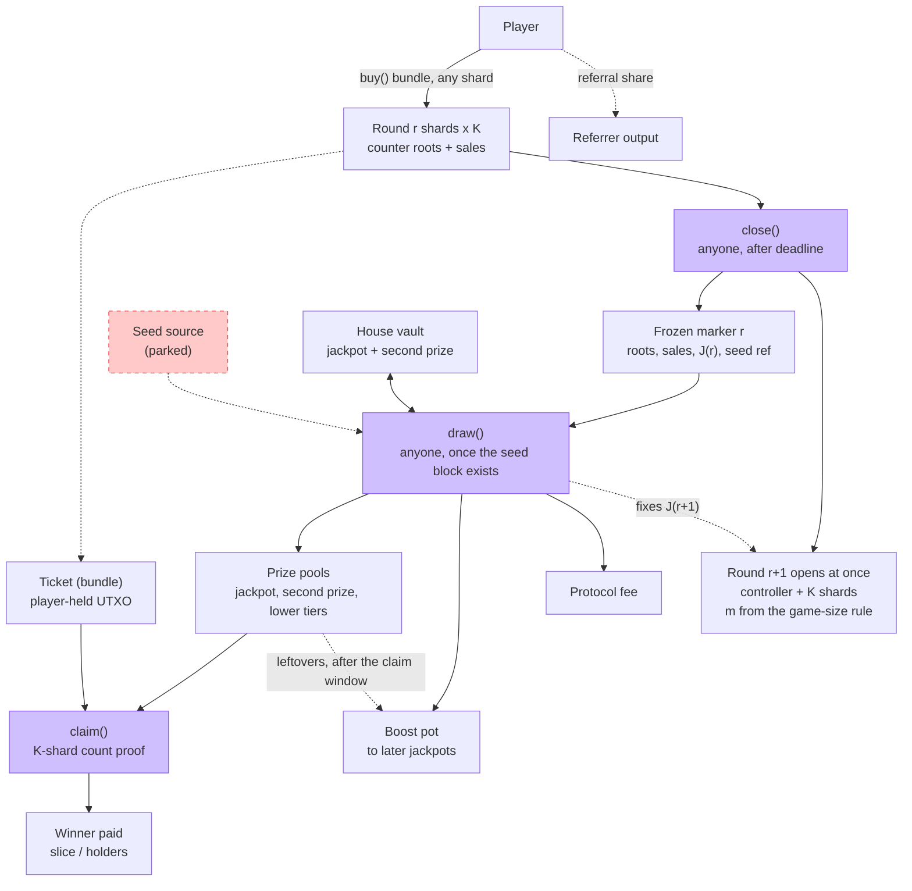

# Kaspa L1 Lottery — Protocol Design v0.4.1

**Date:** 9 October 2026

**Status:** Proposed design. Not implemented or audited. M0 measured its platform limits (`docs/feasibility.md`). Section 2 lists what is established, proposed and open.

**Purpose:** A KAS-only lottery on Kaspa L1 (Toccata covenants). Players buy tickets and claim prizes, and a public function closes each round and opens the next. Every lottery rule is enforced by L1, with no keeper bots and no off-chain lottery logic.

**Revision note (v0.4.1):** adds:
- the fixed 5/30 game with a per-round bonus range m;
- the per-purchase ticket split;
- a backer vault that is the house for the jackpot and the second prize;
- the game-size rule (backer edge and whale check), with the jackpot fixed per round;
- the boost pot;
- the protocol fee and a limited admin key;
- single-level referrals;
- ticket bundles;
- a reserve on every protocol UTXO;
- the pinned releases;
- covenant hygiene rules R5–R8 and the open checks from `docs/research/kaspa-best-practices.md`.

Randomness remains parked (section 11).

# 1. Goal and scope

## 1.1 The goal

A player buys a ticket and, if it wins, claims. That is all a player ever does. The protocol has public functions that anyone may call. The most important one closes the round, opens the next round immediately and leads to the draw. L1 covenants compute and enforce every lottery rule: ticket validity, matching, prize amounts, duplicate sharing, backer settlement, game size and jackpot funding.

## 1.2 What "on L1" means on Kaspa

Kaspa L1 does not execute a function and write the result itself. Every transaction must state its outputs in advance, and covenant scripts accept or reject it. Two consequences shape this design:

-   **Someone must submit each transaction.** This is true on every blockchain; MegaPot's `runJackpot()` also needs a caller. Here every protocol function is public and needs no special key. `close()` and `draw()` pay their caller a reward. Players can call any of them.
-   **Outputs must not require off-chain lottery logic.** Each function's outputs follow directly from its inputs and fixed rules. A wallet only assembles the transaction and attaches proofs that the covenant verifies. No wallet or bot decides who won or how much anyone is paid.

The resulting requirement: **every rule and every result is enforced by L1; off-chain software only proposes transactions and cannot change any outcome.**

## 1.3 Scope

-   **In scope:**
    - tickets and bundles;
    - the round lifecycle;
    - the per-combination counter;
    - the prize model;
    - the ticket split and referrals;
    - the game-size rule;
    - the house vault;
    - the boost pot;
    - the protocol fee and admin parameters;
    - claims;
    - data retention;
    - the safety review and the prototype plan.
-   **Parked:** how the seed is obtained. The design defines where the seed enters (`draw()`), not how it is made unbiased. No real-value launch until it is solved.

## 1.4 Non-negotiable properties

1. KAS is the only deposited and paid asset.
2. Every winning claim is checked on L1 against the winning numbers and the frozen counters.
3. No operator, sequencer, result oracle or keeper is required to run the lottery. The admin key (5.6) is never needed for any lottery function.
4. Every protocol function except `set_params()` is permissionless.
5. Ticket counts are frozen before the seed can be known (this relies on the parked seed design, section 11).
6. The admin key can change only s_F (at most 10%), s_R (at most 15%) and the fee address. A change applies only to rounds opened after it. No one can change the rules of a live round, move prize or vault money, or substitute a draw. Any other rule change requires a new instance.
7. Correctness survives the disappearance of any project-operated service.

# 2. Status

| Area | Status | What closes it |
|:----------------------------|:------------------|:--------------------------------------|
| Introspection, covenant IDs, hashing, byte ops, OpMul/OpDiv, lower-bound locktime | Spec-backed [S1–S2, S8] | Available on mainnet since Toccata |
| Covenant state behind P2SH; ~30 h pruning | Confirmed [S13–S14] | Platform property; design accommodates it (section 9) |
| Multi-input/output stateful covenants in SilverScript, local engine tests | Measured (feasibility Q1, Q3) | — |
| Merkle verify + update in script (OpBlake2b) | Measured (feasibility Q2) | Real shard script in M1 |
| Four-function lifecycle (buy, close, draw, claim) | Proposed | Prototype (section 13) |
| Counter leaf per 5-number key with per-bonus counts (8.2) | Proposed | M1 (buy), M3 (draw) |
| Prize formula and solvency | Proposed; argued in 4.4 | Negative tests in prototype |
| Game-size rule, jackpot fixing, boost hold-back | Decided; details proposed (4.6) | M2, M3 specs |
| House vault settlement at draw, backer shares | Built and tested (M3 settlement, M5 shares; testnet-10 accepted) | Request batching and tuning in M6 |
| Claim window of at least 7 days | Decided | — |
| Reserve R, ticket deposit, largest K for `close()` | Measured lower bounds (feasibility Q4–Q5); M0 shapes accepted on testnet-10 up to K = 62 (Q7) | Final values in M6 |
| Largest bundle per `buy()` (b_max) and m_max | **Open** | M1, M3, M6 measurements |
| Which per-transaction mass limit the network relays | Resolved: the block limits, per transaction (feasibility Q7) | Re-run the testnet-10 probes on each rusty-kaspa bump |
| Covenant family structure and shape policy | **Open** | M1 spec (section 6) |
| Native randomness | **Parked** | Section 11 |

**Pinned releases:**
- rusty-kaspa v2.1.0, commit `01b532e8b553523216471682649693af92f0fd16` [S5]. It has the same consensus rules after Toccata and the same Appendix A limits as v2.0.1 (feasibility Q6). v2.1.0 treats Toccata as always active and has no activation parameter. The mainnet activation score, DAA 474,165,565, appears only in v2.0.1 (`cfafeb4c…`, `consensus/core/src/config/params.rs:724`).
- SilverScript v1.0.0, commit `3ed973335b59269293564805cc2c58a14595ec03` [S3]. SilverScript describes itself as experimental and unaudited.
- KIPs at master `e4ae2332117b5cb68bd6188e065ef885b6d17939`.
- Merkle and protocol hashing use OpBlake2b.

# 3. How it works

## 3.1 The four functions

| Function | Who calls it | What it does |
|:--------------|:----------------|:-------------------------------------------------|
| `buy()` | Player | In any shard of the open round: records every combination of a bundle in the counter, splits the price (5.1), pays the referral output if any and creates one ticket for the bundle |
| `close()` | Anyone, after the round deadline and once the previous round is drawn | Freezes all shards of the ending round, pays the `close()` caller and **opens the next round immediately**. The next round's bonus range m comes from the game-size rule (4.6) |
| `draw()` | Anyone, once the seed block exists | Sets the winning numbers. Proves the jackpot and second-prize counts and funds all prize pools. Settles the house vault, pays the protocol fee and the `draw()` caller, and absorbs expired pools into the boost pot. Fixes the next round's jackpot |
| `claim()` | Anyone (normally the winner) | Proves one bundled combination's total holder count across all K shards and pays its prize to the ticket's fixed payout script |

Supporting functions:
- `return_deposit()`: anyone, after the claim window (7.5). Pays a ticket's deposit to its payout script.
- `set_params()`: admin key (5.6).
- Vault `request_deposit()`, `request_withdraw()` and `settle()` (5.4, 7.5).
- `refresh()` (7.5).

## 3.2 Round timeline

| Time | Event |
|:----------------|:-----------------------------------------|
| Round open | Players `buy()` at any time |
| Deadline T | `close()` becomes valid once round r−1 has been drawn. It freezes round r, chooses m for round r+1 and opens round r+1 in one transaction. After T each shard accepts at most one more buy (7.1), so sales slow to a stop until `close()` |
| After the seed block | `draw()` for round r settles round r and fixes the jackpot J of round r+1 |
| Draw + 7 days | Claim deadline. From then on, any later `draw()` may absorb what is left in round r's pools into the boost pot. `return_deposit()` becomes valid as described in 7.5 |

MegaPot uses the same two-step shape: `runJackpot()` locks the round and requests randomness, and a callback settles it. Here `close()` is the lock (and opens the next round at once), and `draw()` is the settlement.

## 3.3 Flow diagram

# 4. Game and prize model

## 4.1 The game

A combination is 5 distinct numbers from 1..30 plus a bonus number from 1..m. The main game is fixed. Only m changes between rounds, and it is fixed for a round before the round opens (4.6). m_min ≥ 2 so that the second prize exists. The total number of combinations is

> C = choose(30,5) × m = 142,506 × m

A winning combination's tier is set by k, the number of matched main numbers, and by whether the bonus matches. The number of combinations that win a tier is a constant of the game:

> W(k, bonus) = choose(5,k) × choose(25, 5−k) × (1 if the bonus matches, else m−1)

| k | choose(5,k) × choose(25,5−k) |
|--:|--:|
| 5 | 1 |
| 4 | 125 |
| 3 | 3,000 |
| 2 | 23,000 |
| 1 | 63,250 |
| 0 | 53,130 |
| Total | 142,506 |

W does not depend on the winning numbers or on what anyone bought.

## 4.2 Tiers and the combination slice

| Tier | W | Funded by | Prize per winning combination |
|:--|--:|:--|:--|
| 5 + bonus (jackpot) | 1 | House vault (J_house) + boost pot (J_boost) | J (5.3) |
| 5 (second prize) | m − 1 | House vault | G2 = floor(J × g / 10⁴) (5.3) |
| 4 + bonus | 125 | s_t of the round's sales | slice_t |
| 4 | 125 (m − 1) | s_t | slice_t |
| 3 + bonus | 3,000 | s_t | slice_t |
| 3 | 3,000 (m − 1) | s_t | slice_t |
| 2 + bonus | 23,000 | s_t | slice_t |

The set of paying lower tiers and the split of s_t across them are open and are set in the M2 spec. The table shows the candidate tiers. Every paying lower tier t has a budget B_t (5.1), and every winning combination in it owns an equal slice:

> slice_t = floor(B_t / W_t)

All tickets holding the same winning combination share that combination's prize equally:

> prize per holding = floor(slice / h)

Here slice is slice_t, J or G2, and h is the number of holdings of that exact combination: the sum of its counts over all K shards (8.2).

Example odds at m = 10 (C = 1,425,060): jackpot 1 in 1,425,060; second prize 1 in 158,340; 4 + bonus 1 in 11,400; 4 1 in 1,267; 3 + bonus 1 in 475; 3 1 in 52.8; 2 + bonus 1 in 62.

| Situation | Result |
|:------------------------------------|:----------------------------------------|
| One holding of the jackpot combination | Whole jackpot, instantly |
| Three holdings | Each gets one third, instantly, in any order |
| No holding of the jackpot combination | Known at `draw()`: J_house stays in the vault, J_boost stays in the boost pot |
| No holding of a second-prize combination | Known at `draw()`: its G2 stays in the vault |
| No holding of a lower-tier winning combination | Its slice is not paid and goes to the boost pot after the claim window |

Prizes are set per possible winning combination rather than per actual winner, as in MegaPot [S11]. MegaPot gives every winner budget ÷ (W + duplicate winners), which needs tier-wide duplicate totals. This design splits per combination, so it needs only each combination's own count.

**Lower tiers at low coverage.** With N holdings of roughly random combinations, a given combination is held with probability about 1 − e^(−N/C). That is also the expected share of each lower-tier budget that is paid. The rest goes to the boost pot, so it stays with players. Because m is sized by the jackpot (4.6) and not by sales, coverage can be low. For example, 100,000 tickets at C = 1,852,578 pay about 5% of the lower-tier budgets.

## 4.3 Duplicates

h comes from the per-combination counters (section 8). Every `buy()` updates them, and `close()` freezes them before the seed exists. A claimant proves h from the frozen counters of all K shards, so duplicate holders are treated equally regardless of claim order. A bundle may contain the same combination more than once; each occurrence is one holding. Ticket sales per round are unlimited.

## 4.4 Solvency

**Lower tiers.** For each tier t, the holdings of one winning combination receive at most slice_t in total (h × floor(slice_t / h) ≤ slice_t). This holds because h is the exact total over all K shards: `claim()` must prove all K leaves (7.4), so a claimant cannot under-report h. At most W_t combinations win the tier, so total payout ≤ W_t × slice_t ≤ B_t, the pool's value.

**Jackpot.** One combination wins. Its pool is J and pays floor(J / h_J) per holding, at most J in total.

**Second prize.** `draw()` counts n2, the number of the m − 1 second-prize combinations with h ≥ 1 (8.4), and funds a pool of n2 × G2. Each such combination pays at most G2 in total, so the pool cannot be overdrawn. Unheld second-prize combinations are never funded.

**One claim per holding.** A claim marks its bundle index as claimed in the ticket's successor, or consumes the ticket on its last unclaimed index. Each holding therefore claims at most once. Rounding remainders stay in the pool and reach the boost pot when the pool is absorbed.

**House vault.** L = J_house + G2 × (m − 1) is the vault's liability for the round whose jackpot is fixed: the most the vault can pay if the jackpot and every second-prize combination are held. When `draw()` fixes J for a round, it keeps L ≤ cap × V (4.6, cap < 1; applying the cap to the total L is a proposal). Until that round is drawn, withdrawals cannot take the vault below L (5.4). Only one round's jackpot is fixed at any time, so `draw()` can always pay J_house × [h_J ≥ 1] + G2 × n2 ≤ L from the vault.

## 4.5 Claim window

Winners have **at least 7 days** after the draw to claim. Kaspa has no transaction expiry, so the window is enforced from the other side: every action that ends a claim is valid only after the claim deadline (draw + 7 days, checked with a lower-bound locktime).
- `draw()` may absorb a pool only after its deadline. The remainder of every absorbed pool, including unclaimed jackpot and second-prize money, goes to the boost pot.
- `return_deposit()` may consume a ticket only once its round's claim deadline is provably past (7.5).

After the deadline, a winning ticket can still claim until either of these happens. The guaranteed window is the 7 days.

## 4.6 Game-size rule

`close()` of round r chooses m for round r+1. `draw()` of round r fixes J for round r+1. Both apply two checks with the round's committed parameters: price p, the shares (5.1), e, g, margin, m_min, m_max and cap.

**Edge rule** (MegaPot's bonus-range formula [S11]). The expected house payout per ticket must not exceed the house's share of the price after the backer edge e:

> (J_house + G2 × (m − 1)) / C ≤ (1 − e) × s_H × p

So backers keep an expected share e of house income on every ticket. The house cost per ticket is (J_house + G2 × (m − 1)) / (142,506 × m) = G2 / 142,506 + (J_house − G2) / (142,506 × m). This is always above G2 / 142,506, whatever m. Since G2 is a fraction of J, the rule has no solution for any m once

> g × J ≳ (1 − e) × s_H × p × 142,506, i.e. J ≳ 8.96 million × p at the starting values.

**Whale check.** Buying every combination must lose money:

> C × p × (1 − s_t − s_R − s_C − s_D) ≥ margin × (J + G2 × (m − 1))

Subtracting s_C and s_D as well as s_t and s_R is a proposal (confirm in the M2 spec).

A full-coverage buyer recovers four things:
- all lower-tier budgets funded by its own purchase (s_t);
- the referral share, by naming itself as referrer (s_R);
- both caller rewards, by calling `close()` and `draw()` itself (s_C, s_D);
- the jackpot and every second prize.

Since the shares sum to 1, the left side equals C × p × (s_H + s_F). Consequences:
- If margin ≤ (s_H + s_F) / ((1 − e) × s_H), the edge rule already implies the whale check for the house part. That bound is 1.256 at the starting values, and at least 1/(1 − e) = 1.176 for any s_F and s_R.
- Only the boost pot J_boost can then fail the whale check.
- The margin is open (M2 spec) and must respect this bound.

Lower-tier money funded by *other* players' purchases is not in the check, because it cannot be bounded at `close()`. A whale profits from it only if others buy well over C combinations, and then duplicates dilute the whale's jackpot. This is an open item for the M2 spec.

**Choosing m (at `close()` of round r).** `close()` cannot read the vault. It estimates the next jackpot from the vault value V_rec recorded in the controller by `draw()` of round r−1:

> Ĵ_house = floor((V_rec + H_r) × j / 10⁴), Ĵ_boost = boost pot in the round r+1 controller after `close()` (J_boost(r) has moved to the marker) plus round r's boost contribution b_r, Ĵ = Ĵ_house + Ĵ_boost

H_r is round r's house share. m(r+1) is the smallest m in [m_min, m_max] for which both checks hold at Ĵ, and G2 is evaluated from Ĵ. If no m in range passes, m(r+1) = m_max, and `draw()` reduces J as below.

**Fixing J (at `draw()` of round r)** *(proposal; confirmed in the M2/M3 specs)*. Let V' be the vault after round r's settlement (5.4) and O' the boost pot after round r's additions. `draw()` computes, in this order, with m = m(r+1):
1. **Base.** J_house = floor(V' × j / 10⁴), J_boost = 0.
2. **Boost.** If the base already fails either check or the cap (J_house + G2 × (m − 1) ≤ floor(V' × cap / 10⁴)), first lower J_house to the largest value that passes all three with J_boost = 0. Then J_boost = the largest b ≤ O' for which all three still hold.
3. **Top-up.** Raise J_house to the largest value for which:
   - both checks still hold;
   - J_house + G2 × (m − 1) ≤ floor(V' × cap / 10⁴).

   The top-up never lowers J_house.
4. Record J(r+1) = J_house + J_boost, G2(r+1) and L(r+1) in the controller of round r+1. The boost pot keeps O' − J_boost (the hold-back).

Each "largest value" is a closed-form floor division, because both checks are linear in J_house and J_boost. Both checks hold at the end by construction. J(r+1) is fixed before most of round r+1's sales and never changes. Ĵ is an estimate, not an upper bound: the top-up and vault deposits can raise J above it, and the hold-back, the cap and payouts can lower it. Every bound that matters is re-checked when `draw()` fixes J. Buyers before `draw()` of round r see Ĵ as an indication only.

Top-up moves edge above target to players. Because m is a whole number, the edge rule usually holds with slack at the chosen m. Step 3 spends that slack on a larger jackpot instead of leaving it with backers.

**Worked example (starting values, open values assumed).**
- Inputs: p = 1 KAS; V' = 10,000,000 KAS; boost 0.
- Shares: s_H = 74%, so (1 − e) × s_H = 0.629, and the allowance per combination is 0.629 KAS.
- Base: J_house = 1,000,000 KAS and G2 = 10,000 KAS.
- m: the edge rule needs 1,000,000 + 10,000 (m − 1) ≤ 89,636 m, so m = 13 and C = 1,852,578.
- Top-up: raises J_house to 1,040,421 KAS (the edge exactly 15%), if the cap allows it. With G2 = floor(J × g / 10⁴) = 10,404 KAS, liability L = 1,165,269 KAS, about 11.7% of V'.
- Whale check: 1,852,578 × 0.79 = 1,463,537 ≥ margin × 1,165,269, which holds for any margin ≤ 1.256.
- Other jackpots at this price: J = 5,000,000 needs m = 125.

**Arithmetic.** Each comparison is ordered so that every intermediate fits in signed 64 bits. For example, the allowance per combination a = floor(p × (10⁴ − e) × s_H / 10⁸) is computed first, then multiplied by C. Rounding always favours the checks. The M2 spec lists the order of operations and the maximum of every quantity.

# 5. Money model

## 5.1 Ticket split

The ticket price is p = 1 KAS per combination, and a bundle of b combinations costs P = b × p. Shares are committed in basis points and sum to 10,000.

| Share | Starting value | Goes to | When |
|:--|--:|:--|:--|
| Protocol fee s_F | 5% (500 bp), admin-adjustable ≤ 10% | Fee address, via the controller's fee accumulator | Carried in the frozen marker; paid at `draw()` when the total reaches the minimum output, otherwise added to the accumulator |
| Referral s_R | 10% (1,000 bp), admin-adjustable ≤ 15% | Referrer output named by the buyer; else boost pot | Inside `buy()` |
| `close()` reward s_C and `draw()` reward s_D | ≈ 1% in total (exact split set in the M2 spec) | The caller's own output | At `close()` / `draw()` |
| Lower-tier budgets s_t | ≈ 10% in total (split per tier open, M2 spec) | Lower-tier prize pools | At `draw()` |
| House share s_H | Remainder, ≈ 74% | House vault | At `draw()` |

**Referral (inside `buy()`).** The referral amount is r = floor(P × s_R / 10⁴). It is paid as one output to the standard script the buyer names, only if r ≥ M_ref. M_ref is the minimum referral output, set in M1 from storage mass (5.5). A buyer may omit the output; the share then stays in the shard. The shard records gross sales S and referral paid P_R. The referral is one level only and has no share of winnings. A buyer can name themselves as referrer, so s_R is a rebate available to anyone. The whale check counts it (4.6).

**Round amounts.** For round r with gross sales S and referral paid P_R:
- every share except the referral is computed once on S as floor(S × s / 10⁴): F, C_close, C_draw, each B_t and H;
- the boost contribution is the residual, b_r = S − P_R − F − C_close − C_draw − ΣB_t − H.

b_r ≥ 0 because P_R is a sum of floors and so is at most floor(S × s_R / 10⁴). It is the unpaid referral share plus all rounding remainders.

The shares a round uses are snapshotted when the round opens (5.6).

## 5.2 Who owns what

| Pot | Funded by | Owner | If not won or not claimed |
|:-----------------|:-----------------------|:-------------------|:----------------------------|
| House vault | Backer capital + s_H of every round's sales | Backers (shares) | Pays J_house and second prizes; unheld ones stay in the vault |
| Jackpot J = J_house + J_boost | Vault (J_house) and boost pot (J_boost), fixed at the previous `draw()` | Holders of the jackpot combination | Not held: J_house stays in the vault and J_boost stays in the boost pot. Held but unclaimed: the boost pot |
| Second prize G2 per combination | Vault | Holders of each second-prize combination | Not held: stays in the vault. Held but unclaimed: the boost pot |
| Lower-tier budgets B_t | s_t × sales of the same round | Holders | Unbought or unclaimed: the boost pot |
| Boost pot O | Lower-tier leftovers, unclaimed jackpot and second-prize money, unpaid referral shares, rounding remainders, unheld J_boost | Players' prize money | Added to later jackpots (4.6) |
| Fee accumulator | s_F × sales | Fee address | Paid at `draw()` when ≥ the minimum output, else carried |
| Caller rewards | s_C, s_D × sales | Callers | Paid per call |
| Referral | s_R × purchase | Named referrer | Below M_ref or none: the boost pot |

Lower-tier money never touches backer capital, and backer capital never funds lower tiers. The boost pot is player money and never flows to the vault.

## 5.3 Jackpot and second prize

> J = J_house + J_boost and G2 = floor(J × g / 10⁴), both fixed by the previous `draw()` (4.6) and recorded in the controller and then the frozen marker.

`draw()` of round r proves, from the K frozen leaves of the winning five main numbers (8.4):
- h_J, the jackpot combination's total count;
- n2, the number of other bonus values whose total count is ≥ 1.

It then funds:
- **h_J ≥ 1:** a jackpot pool of J. J_house comes from the vault, and J_boost from the frozen marker, where `close()` put it. Each holding claims floor(J / h_J).
- **h_J = 0:** no jackpot pool. J_house stays in the vault and J_boost returns to the boost pot.
- **n2 ≥ 1:** a second-prize pool of n2 × G2 from the vault. Each holding of a held combination claims floor(G2 / h).

Starting values: j = 10% of the vault (the base for J_house), g = 1% (100 bp). G2 is a fraction of the whole J, so a large J_boost also raises the vault's second-prize cost. The edge rule accounts for this.

## 5.4 House vault

The vault is the house for the jackpot and the second prize. At `draw()` of round r:

> V' = V + H_r − J_house × [h_J ≥ 1] − G2 × n2

This settlement is exact, so backers' results are final at every draw. No vault money is locked after a draw except the next round's liability L(r+1) (4.4).

**Shares, deposits and withdrawals.** Backers hold vault shares. Deposit and withdrawal requests convert at the share price set by the next `draw()` after the request (V' ÷ shares, after settlement), as in MegaPot's pending-deposit and pending-withdrawal model [S12]. Withdrawals cannot take the vault below L of the round whose jackpot is fixed, until that round is drawn. J(r+1) is fixed from V' before any of that draw's conversions, so a new backer cannot capture returns from earlier rounds. The request, conversion and settlement transactions are specified in the M5 spec (`docs/specs/5.md`, D65–D79):
- **Internal accounting.** The vault state holds total_assets, total_shares, the pending deposit assets and the pending withdrawal shares, and the UTXO value equals total_assets + pending deposits + R at every transition. Outside value is never counted.
- **Requests** *(confirmed in the M5 spec: D65, D69, D72)*. `request_deposit()` and `request_withdraw()` spend the vault, add the request to its pending totals and create a vault request UTXO; a deposit's KAS enters the vault's value at that point. The request targets the vault's next draw and is irrevocable. Only the position's owner can request a withdrawal: the transaction must spend an input whose scriptPubKey equals the owner's script (P2PK Schnorr, P2PK ECDSA or P2SH, D67). A withdrawal may take part of a position; the rest stays in the position.
  - `draw()` converts the pending totals in aggregate, at its post-settlement price: it mints shares for pending deposits and burns pending withdrawal shares. It writes one settlement record when anything is pending, so `draw()` never gathers individual requests and its input count does not depend on them.
  - Withdrawals are capped so the vault keeps L(r+1), counting the same draw's converted deposits (D69). The excess stays pending, pro rata, for the next draw.
  - Each request is later settled against that draw's record by `settle()`, by anyone (D77): a share position for a deposit, a payout for a withdrawal. Each settlement takes its pro-rata part of the record's *remaining* totals, rounded down, and the last settler of each side takes exactly what is left, so nothing is left as dust (D72). Amounts are fixed at the draw, so the owner's timing gives no option. A drained record is consumed and its R refunded to its funder.
  - There is no cancellation. A refund exists only if the target draw never happens (parked missed-draw item).
  - Because the price is set after the round's own settlement, knowing that round's seed early gives no advantage. The research doc's "lock before the seed" requirement (E4) is therefore not needed. *Flag: deviation from the research doc.*
  - Requests serialize on the vault UTXO and must wait until the vault is VAULT_REQ_DELAY = 600 DAA old, so after every vault spend `draw()` has a window in which no request can race it. This allows at most one request per 600 DAA (about 1,440 a day), won by the highest fee; batching and request griefing are open for M6 (DECISIONS 2026-10-12, U-4, U-6).
- **Rounding.** Shares round down on deposit and assets round down on withdrawal. A zero-share mint is impossible: `draw()` converts the deposits only if the aggregate mint gives every request at least one share; otherwise the record is in refund mode and each deposit settlement repays its deposit (D70). A withdrawal payout below P_MIN accrues in the request and is paid with its final settlement. Products of shares and prices use `mulfrac` (floor(a × r / c) without a 64-bit overflow, D73) and are range-checked (R8).
- **Share-price attacks.** A virtual offset defends against share-price manipulation: the price is (A + VA) / (S + VS) with VS = 1,000 virtual shares and VA = 1 sompi, so no division by zero is possible. Genesis mints S₀ = floor(V₀ / SHARE_UNIT) shares (SHARE_UNIT = 1,000 sompi) into a share position owned by the deployer (D66). A floor on S₀ relative to VS is open for M6 (U-5).
- **Inflows.** Inflows that raise the share price without minting shares, such as the house share, enter only at `draw()`.

## 5.5 Conservation

**Reserves.** Every protocol UTXO carries a fixed reserve R on top of its economic value. This covers the controller, the shards, the frozen marker, the prize pools and the vault. It exists because zero-value outputs are invalid and small outputs exceed storage mass (feasibility Q4).
- R moves with the object.
- A transaction that creates more protocol objects than it consumes has its caller post the extra reserves. Each new object records the funder's payout script and repays R to it when it is finally consumed.
- `close()` funds the marker's R, refunded at `draw()`.
- `draw()` funds each new pool's R, refunded when a later `draw()` absorbs the pool.
- Controller, shard and vault reserves are posted once at deployment.

**No standalone tiny outputs.** Caller rewards are added to a caller-chosen output that also carries the caller's change and any refunded reserve. The protocol fee is paid only when it is at least the minimum output. A referral output exists only when it is at least M_ref.

**Statements.** These are over economic value, excluding R. Transaction fees always come from the caller's own inputs.
- **`buy()`:** the shard's value increases by P − r. The referral output (if any) is r. The ticket holds its deposit d × b from the buyer. The shard's S increases by P and its P_R by r.
- **`close()` of round r:** consumes the controller (boost pot O_r plus fee accumulator A) and the K shards (Σ(S_k − P_R,k) = S − P_R). It creates:
  - the frozen marker, holding S − P_R − C_close + J_boost(r);
  - the controller of round r+1, holding O_{r+1} + A with O_{r+1} = O_r − J_boost(r);
  - K empty shards;
  - the caller's output, holding C_close.

  Reserves follow the reserve rule. `close()` consumes no object that carries a borrowed reserve, so it makes no refund.
- **`draw()` of round r:** inputs are:
  - the marker (S − P_R − C_close + J_boost);
  - the vault V;
  - the controller of round r+1 (O_{r+1} + A);
  - absorbed pools with remaining values ΣQ_i.

  Outputs are:
  - the jackpot pool (J × [h_J ≥ 1]);
  - the second-prize pool (n2 × G2);
  - the lower-tier pools (ΣB_t);
  - the vault, holding V' after settlement, then adjusted by that draw's aggregate conversions (5.4);
  - the draw's settlement record when anything is pending, holding the converted withdrawals' payout (plus the deposits, in refund mode) (5.4);
  - the fee payout (A + F, when ≥ the minimum output);
  - the caller's output (C_draw);
  - the controller of round r+1, holding O' + A' (A' = 0 if the fee was paid, else A + F);
  - one reserve refund of R to the recorded funder of the marker and of each absorbed pool (R2 fixes these indices).

  The boost pot becomes O' = O_{r+1} + b_r + J_boost × [h_J = 0] + ΣQ_i, of which J_boost(r+1) is reserved for the next jackpot (4.6).
- **`claim()`:** the pool decreases by exactly the prize. The payout output is the prize plus, on the ticket's last claim, the deposit.
- **`return_deposit()`:** the ticket's deposit goes to its payout script; a co-spent pool (7.5) is recreated unchanged.
- **`set_params()` and `refresh()`:** value unchanged.

## 5.6 Protocol fee and admin parameters

The fee s_F accumulates in the controller (via the frozen marker) and is paid once per `draw()` to the fee address. When the accumulated amount is below the minimum output, it carries to the next draw.

An admin key, committed at deployment, can change s_F, s_R and the fee address. The covenant enforces s_F ≤ 1,000 bp and s_R ≤ 1,500 bp. s_H stays the remainder.

**Storage** *(proposal; confirmed in the M2 spec).*
- The parameters live in the round controller, together with one pending slot.
- `set_params()` spends the open round's controller. It is authorised by the admin key and allowed at most once per round. It checks the caps and writes the pending slot.
- The next `close()` copies the pending values into the parameters of the round it opens, and snapshots s_R and the price into the new shards.
- `close()` already spends the controller, so reading the parameters needs no extra input and causes no contention.
- If the admin key is lost, the parameters are frozen at their last values. The protocol never needs the admin key to act.
- The controller stores blake2b(admin pubkey). The admin signature covers (domain tag, covenant ID, target round, new parameters, nonce), and the controller stores a monotonic nonce, which prevents replay onto another round or a look-alike family. The key is declared as a KCC-02 `p2pkh-schnorr/v1` principal, pinned to the draft revision used.
- **Admin key and value-holding UTXOs.** The admin key has no spend path on pools, the vault or tickets. `set_params()` does spend the controller, which holds the boost pot and the fee accumulator. The script requires the controller's value and every non-parameter field to be unchanged. *Flag: best practice K3 says the admin should have no spend path on value-holding UTXOs. The alternative is a separate parameter UTXO that `close()` also spends. Decide in the M2 spec.*

# 6. State objects

| Object | Contents | Lifetime |
|:----------------------|:----------------------------------------|:---------------------|
| Round controller | Round number, m, price, deadline (absolute DAA), active shares and pending admin parameters, fee address, admin key, J(r), J_boost(r), G2(r), L(r), V_rec, fee accumulator A, previous-round-drawn flag, set-params-used flag, reserve funder. Value: boost pot + A (+ R) | One round |
| Shard (K per round) | Round, shard index, m, price, deposit d, s_R, counter root, gross sales S, referral paid P_R. Value: S − P_R (+ R) | One round |
| Ticket | Round, round deadline T (absolute DAA, from the shard), bundle of combinations (6 bytes each), claimed bitmap, payout script. Value: d × b | Until fully claimed or deposit returned |
| Frozen marker | Round, all K roots, S, P_R, m, J, J_boost, G2, shares, absolute seed reference, reserve funder. Value: S − P_R − C_close + J_boost (+ R) | Until `draw()` |
| Prize pool (jackpot, second prize, each lower tier) | Round, tier, slice (J, G2 or slice_t), winning numbers, m, K roots, claim deadline, reserve funder | Until absorbed after the window |
| Round result record | Winning numbers, roots, slices, m, claim deadline, pool reserve funder: the public data claimants need and pools are rebuilt from | Kept by wallets and indexers (section 9) |
| House vault | Last drawn round, total_assets, total_shares, pending deposit assets, pending withdrawal shares, locked liability L, and the record, request and position template hashes (instance constants set at genesis). Value: total_assets + pending deposits + R | Permanent, touched every draw and every request |
| Vault request | Target draw, kind (deposit or withdrawal), amount (deposit sompi or withdrawal shares), owner (script class and key). Value: R + accrued payouts | Until settled against its draw's record |
| Draw settlement record (per draw) | Round, request template hash, refund flag, remaining deposit assets, shares to mint, withdrawal shares, shares to burn and assets to pay, reserve funder. Value: remaining payout + (deposits, in refund mode) + R | Until both sides are drained by settlements |
| Share position | Round of the minting draw (informational), shares, owner (script class and key). Value: R | Until fully withdrawn |

Every state begins with a role byte and its round number (R5).

**Design rules:**

-   **R1 Full state bytes.** Every successor's state is built from bytes present in the transaction, so state is published whenever it changes.
-   **R2 Enumerated shapes.** Every transition fixes input and output counts, indices and covenant bindings, and rejects extra outputs. These checks are hand-written, because SilverScript's covenant declarations count only an input's authorized outputs and allow extra outputs (feasibility Q1):
    - `tx.inputs.length` and `tx.outputs.length`, with explicit indices;
    - for each covenant family the transaction touches, exact OpCovInputCount and exact OpAuthOutputCount, plus OpCovOutputCount = OpAuthOutputCount. KIP-20 allows several authorization groups with the same covenant ID in one transaction, so without these checks a second protocol UTXO could ride along unvalidated;
    - continuation outputs selected with OpAuthOutputIdx(active input, k), or by asserting OpCovOutputIdx(cov, 0) = 0;
    - OpOutputCovenantId only for genesis outputs, and to check that unbound outputs (caller, referral, fee, payout, change) report the zero ID.

    SilverScript v1.0.0 does not expose OpOutputAuthorizingInput; the authorized-output index is its exposed equivalent. *(Proposal; confirm in the M1 spec. It replaces the per-index covenant-ID check proposed with v0.4.1 (DECISIONS rows on R2 and the design rename), which proves membership but not which input authorized the output.)*
-   **R3 Absolute time.** Deadlines and the seed reference are stored as absolute DAA scores and never derived from when an object was last spent.
-   **R4 Reconstructible state.** Prize pools, which can stay idle for days, carry only data reconstructible from the round result record and their UTXO value. The controller and the vault are spent at least once per round.
-   **R5 Authenticated roles.** Every state starts with a role byte and the round number. Every consumer checks covenant ID + role + round before using an input.
    - Another role's state is read only with `readInputStateWithTemplate` and written only with `validateOutputStateWithTemplate` or `validateOutputStateWithInputTemplate`.
    - Template hashes come from state or constants, never from the caller. They are computed with `templateHash(prefix, suffix)`. The controller holds the route table of role template hashes.
    - SilverScript's `#[covenant…]` declaration wrappers are used only for same-template hops, such as a shard updating itself. Cross-role routes are hand-written (feasibility Q1; SilverScript DECL.md).
-   **R6 Leader and delegates.** `close()` and `draw()` have one leader at covenant input 0 that validates the whole transition: the controller for `close()`, the frozen marker for `draw()`. Every other covenant input is a delegate. A delegate rejects index 0, requires OpAuthOutputCount = 0 when it authorizes nothing, and authenticates the leader's template. Every non-delegate entry of a shard requires OpCovInputCount = 1; the companion shard-logic fallback (7.1) would change this count. In `claim()` the pool validates the shape and the ticket checks that a genuine pool of its round is present. `claim()` and `return_deposit()` each spend exactly one ticket.
-   **R7 Exact values and fixed plain outputs.** Every covenant output has an exact value, and every split has an explicit remainder rule (b = total − a). Plain outputs carry no covenant binding, so the authorized-output iterators cannot pair them with an input. Each one (payout, referral, fee, caller output, reserve refund, change) sits at a fixed declared index with an exact value. Every newly created UTXO, such as a ticket or a vault request, has its initial state validated at creation.
-   **R8 Defined behaviour.** In SilverScript, overflow and division by zero are undefined behaviour that the compiler may remove, not guaranteed failures. Scripts range-check every integer before + − × ÷ %, check byte lengths before casts and slices, and bound loops explicitly. Each entry point checks its full precondition set. Arguments the transaction does not commit to, such as proofs and selectors, are checked against committed data.
-   **Shape policy (open, M1 spec).** As written, R2 is strict: every input and output, including the caller's funding input and change output, has a fixed index, and nothing else is allowed. The research recommends a looser alternative: exact covenant counts and values, plus at most one plain fee input and one change output, with no covenant ID. *Flag: that alternative loosens the CLAUDE.md non-negotiable "extra outputs are rejected" and needs your decision.* Either way the reserve R never pays fees.

# 7. Transitions

## 7.1 buy()

Spends one shard s (the buyer picks any shard of the open round), the buyer's funding and optional fee inputs. Creates, at fixed indices:
- the successor shard;
- one ticket;
- the referral output (optional);
- the buyer's change.

These are two enumerated shapes, with and without the referral output. The shard script checks:

-   The bundle has 1 ≤ b ≤ b_max combinations. b_max is a committed constant (see below).
-   Each combination is canonical: 5 sorted distinct numbers in 1..30 and a bonus in 1..m, with m read from the shard.
-   For each combination in order, a Merkle path proves the current leaf of its five main numbers, and the successor root is that tree with the bonus count incremented (8.2). Combinations sharing main numbers update the same leaf one after another.
-   The shard value increases by exactly b × p − r. S increases by b × p and P_R by r.
-   If the referral output is present, it pays exactly r = floor(b × p × s_R / 10⁴) ≥ M_ref to a standard script class.
-   The ticket output carries d × b, the bundle bytes, a zero claimed bitmap and a payout script of a standard class. Its full initial state is validated (R7). It is created under the round's covenant family (KIP-20), so tickets cannot be created any other way.
-   *Late-buy bound (proposal; confirm in the M1 spec).* The spent shard's creation DAA score (OpTxInputDaaScore) must be below the round deadline T. A shard created at or after T accepts only `close()`. Each shard therefore takes at most one buy after T, so buyers cannot starve `close()` by respending shards. Lock time can prove only "after T", so the cut-off is structural: `close()` spends the shards, plus this rule. Buys can still land between T and `close()`.

**Bundle size and K.** Scripts have no loops, so the per-combination checks are unrolled b_max times in the shard script. Every shard input of `close()` carries the shard's whole redeem script, and shard script size bounds K (feasibility Q5: K ≤ 23 at a 10 kB shard sigscript). b_max is therefore a committed constant, small enough to keep K at its target. M1 measures script size per bundle slot. If a useful b_max costs too much K, there are two fallbacks:
- a companion shard-logic UTXO that is spent alongside the shard in `buy()` and holds the per-combination checks, so the shard's own script stays small for `close()`;
- a per-shard seal step before `close()`.

Buyers of the same shard at the same moment conflict. One succeeds and the other's wallet rebuilds against the new shard state or picks another shard.

## 7.2 close()

Valid only after the round deadline (lower-bound locktime) and only if the controller's flag shows that round r−1 has been drawn. Spends the controller and all K shards of round r and the caller's funding. Creates:

-   the frozen marker for round r. It records all K roots, S, P_R, m, J, J_boost, G2, the shares and the seed reference (the maximum creation DAA score of its inputs plus a committed offset, stored as an absolute value). Its value is in 5.5;
-   the controller for round r+1:
    - m(r+1) from the game-size rule (4.6) and the parameters (pending admin values applied);
    - the boost pot and fee accumulator carried over;
    - the previous-round-drawn and set-params-used flags cleared;
-   K empty shards for round r+1, each recording m, the price, d and s_R;
-   the caller's output with C_close and change (the caller also posts the marker's R).

Because round r's shards are consumed, no purchase can change round r's counters after `close()`. Purchases in flight against old shards fail and rebuild against round r+1. This is the sales cutoff; no transaction-expiry primitive is needed. Requiring round r−1 to be drawn first keeps the rounds strictly ordered. If a `draw()` is late, the next round's shards each accept one buy after its deadline and then wait for `close()`, so sales pause until the late draw happens.

`close()` sets the next deadline T(r+1) = max(scheduled deadline, its own DAA score + D_min), where D_min is a committed minimum sales period. Its own DAA score is the maximum creation DAA score of its inputs, as for the seed reference. New shards are therefore always created before their round's deadline, so a late `close()` cannot open a round that sells nothing *(proposal with the late-buy bound; confirm in the M1/M2 specs)*.

## 7.3 draw()

Valid once the seed source for the frozen marker's seed reference exists (parked, section 11). Spends:
- the frozen marker of round r;
- the house vault;
- the controller of round r+1 (still open, because `close()` of round r+1 waits for this draw);
- any prize pools past their deadline;
- the caller's funding.

The script:

-   derives the winning numbers from the seed: 5 distinct numbers in 1..30 and a bonus in 1..m, by a bias-negligible mapping;
-   verifies the K leaves of the winning five main numbers against the K frozen roots, and from them computes h_J and n2 (8.4);
-   computes each lower-tier budget and slice from S and the shares, and the jackpot and second-prize pools from J, G2, h_J and n2 (5.3);
-   creates one pool per paying lower tier, plus the jackpot pool if h_J ≥ 1 and the second-prize pool if n2 ≥ 1. Each carries the winning numbers, m, the K roots and the claim deadline;
-   settles the vault (5.4), pays the protocol fee if it reaches the minimum output, pays C_draw to the caller and absorbs expired pools into the boost pot;
-   converts the vault's pending requests in aggregate and, when anything is pending, creates the settlement record at output 3 + np (np = the number of new pools), with its R posted by the caller (5.4);
-   fixes J(r+1) by the rule in 4.6 from V' before the conversions, records it with V_rec = the vault's total_assets after the conversions (D71) in the round r+1 controller, and sets its flag.

Every output follows from the inputs and fixed rules. The caller's wallet assembles the transaction and the K proofs; it decides nothing.

## 7.4 claim()

Spends one ticket and the prize pool of the claimed combination's tier. Creates:
- the successor pool;
- the ticket successor with the index marked claimed, unless this was the ticket's last unclaimed index;
- the payout.

The covenant checks:

-   the transaction spends exactly one ticket, so one payout output cannot satisfy two claims;
-   the ticket belongs to the pool's round and covenant family, and the bundle index is unclaimed;
-   that combination matches the winning numbers at this pool's tier;
-   K Merkle proofs, one per shard. Proof i is checked against root i of the pool's round. h is the sum of the combination's bonus count over the K leaves. All K are required, so h cannot be under-reported;
-   the payout is floor(slice / h) to the ticket's payout script, at its fixed index, plus d × b if the ticket is consumed;
-   the pool decreases by exactly the prize.

Anyone may submit a claim, because the payout script is fixed in the ticket; the submitter pays the transaction fee. Claims within one tier contend for that tier's single pool. With claims spread over at least 7 days this is acceptable, and conflicting claims are simply resubmitted. The proof is about K × (18 × 32 + leaf bytes): about 9.9 kB at K = 16 and m = 10.

## 7.5 Other transitions

| Transition | Rule |
|:----------------|:------------------------------------------------|
| `return_deposit()` | Anyone. The ticket cannot read the claim deadline, because `draw()` sets it after the ticket exists. *Proposal (confirm in the M4 spec):* valid either (a) when co-spending any prize pool of the same round whose claim deadline has passed (lower-bound locktime; the pool is recreated unchanged), or (b) from T + D_ret. T is the round deadline stored in the ticket. D_ret is a committed delay of at least the allowed draw delay plus 7 days, which covers rounds whose pools were all absorbed. Consumes the ticket and pays d × b to its payout script. Unclaimed winning indices are forfeited, as they would be at absorption. If `draw()` is later than T + D_ret − 7 days, path (b) shortens the window; this belongs to the parked missed-draw item |
| `set_params()` | Admin key only, once per round, caps checked in script. Writes the pending slot of the open round's controller (5.6) |
| `request_deposit()` / `request_withdraw()` | Backer requests: spend the vault (once it is 600 DAA old), add to its pending totals and create a vault request. A deposit names any owner; a withdrawal needs the position owner's input and may be partial (5.4) |
| `settle()` | Anyone. Settles one request against its draw's settlement record: a share position for a deposit (or the deposit back in refund mode), a payout for a withdrawal, with the request's R returned to its owner (5.4) |
| `refresh()` | Any idle long-lived object may be re-spent into an identical successor after an idle delay, republishing its state (R3 keeps all times fixed). This covers the marker, pools, tickets, share positions, vault requests and settlement records; the vault needs none, because every `draw()` re-spends it |

# 8. The combination counter

## 8.1 What it counts

For each round, the number of holdings of each exact combination. It is one of MegaPot's 31 per-ticket counters: the full-combination counter MegaPot uses for duplicate detection [S10]. The other 30 (subsets of the combination) exist in MegaPot to compute tier-wide winner totals, which this design does not need (5.3).

## 8.2 Structure *(leaf layout: proposal, confirmed in the M1 spec)*

-   Each of the K shards of a round holds the root of a sparse Merkle tree. The key is the rank of the five main numbers in 0..142,505, so every path has fixed depth 18.
-   A leaf holds m fixed-width counts, one per bonus value. Hashing is domain-separated, with distinct tags for leaf, internal and empty nodes: leaf H(0x00 ‖ rank ‖ counts), node H(0x01 ‖ left ‖ right), and a separate empty-node tag. The hash is OpBlake2b. The empty-leaf rule (an absent key means all counts 0) is specified in M1.
-   Siblings are passed as one flat byte string of 32 × depth bytes, and its length is checked before slicing. The stack holds at most 244 items, so one item per hash would overflow at K paths.
-   Before the hash is frozen, M1 benchmarks OpBlake3 against OpBlake2b for K-path claims. The research estimate is about half the script units per hash; M0 measured only a 4.5% saving on a whole single path (feasibility Q2).
-   A buyer may use any shard, so a combination's holdings are spread over shards. Its count h is the sum of its bonus count across the K leaves for its main numbers.
-   A purchase supplies, per combination, the leaf bytes and the Merkle path. The script uses the same path twice: to check the old leaf against the current root and to compute the new root with one count incremented.

**Cost of the layout.**
- One leaf per shard proves the jackpot count and all m − 1 second-prize counts.
- `draw()` needs K leaves and paths. Its script sums m counts across K leaves, unrolled, so m_max is bounded by `draw()` script size (measured in M3 and M6).
- A proof is K × (576 + leaf bytes) bytes: about 9.9 kB at K = 16 and m = 10, and 15.6 kB at m = 100 with 4-byte counts.
- If m_max must be large, the fallback is a small sub-tree over each leaf's bonus counts: more hashing, a smaller `draw()` script.

## 8.3 Why sharding

Every purchase must spend one shard. With one global counter, all buyers would conflict. With K shards and free choice of shard, buyers spread out and proceed in parallel. K is limited by how many shards `close()` can consume in one transaction: 23–62 depending on shard script size, bound by transient mass (feasibility Q5). Larger K makes the `draw()` and `claim()` proofs larger.

## 8.4 Proofs after the close

After `close()`, each shard's root is frozen in the marker and copied into every prize pool.
- `draw()` proves the K leaves of the winning main numbers. From them it reads h_J (the winning bonus's count summed over K) and n2 (the number of other bonus values with a nonzero sum).
- Each `claim()` proves its combination's K leaves.

# 9. Data availability and retention

Kaspa nodes keep only the hash of a covenant's state. The data itself is in transactions, which normal nodes prune after about 30 hours [S13–S15]. What each party needs, and from where:

| Data | Needed by | Source |
|:----------------------|:------------------|:------------------------------------------|
| Current shard tree | Buyers, to build their purchase proof | That shard's purchases in the current round, all on normal nodes while the round is shorter than 30 h |
| All K frozen shard trees | Winners, for the claim proof; the `draw()` caller, for the jackpot and second-prize proof | All purchases of the round. The earliest leave normal nodes about 30 h after they were made, so with daily rounds the full set is on normal nodes for only about 6 h after `close()` |
| Round result record | Claimants | Published by `draw()`; small |
| Own ticket | Its holder | The holder's wallet, like a private key |

**Rule for wallets:** a wallet holding tickets keeps a copy of **all K** shard trees of the round. It gets them by following all purchases during the round or by downloading them within about 6 hours after `close()`. After `draw()` it builds the claim proofs for its winning combinations from that copy, downloads the round result record, and can then claim at any time in the window. The `draw()` caller builds its proof the same way.

**Residual dependency:** a winner whose wallet missed that period needs a copy of the shard trees from any indexer or archive. Any copy works and can be checked against the frozen roots. This is the same one-copy assumption every Kaspa covenant application carries. Long-lived objects follow R4 and can be refreshed.

**Indexer and launch bundle.**
- No node RPC lists UTXOs by covenant ID, so the project runs its own indexer. It tracks the covenant IDs, live UTXOs, creating transactions, redeem-script preimages, genesis data and template hashes, and handles the v2 RPC fields (`covenant`, `covenant_id`, `computeBudget`, `storage_mass`).
- A launch bundle is published and archived against pruning: genesis outpoint, authorized genesis outputs, derived covenant ID, template preimages and live UTXOs. With it, anyone can verify the instance independently.
- The transaction builder sizes each v1 input's compute budget with `ComputeBudget::checked_covering_script_units`. It takes fees from the node's estimator, at least 100 sompi per gram.

**Timing constraint:** round length plus the time to obtain the shard trees must stay under about 30 hours. Daily rounds leave about 6 hours; shorter rounds leave more. Round length is therefore an open parameter (section 14). A round can overrun when its predecessor's `draw()` is late. Its sales then pause after its deadline (7.2), but its earliest purchases may leave normal nodes before `close()`. Winners and the `draw()` caller then depend on wallets that followed the round or on any indexer copy, checked against the roots.

# 10. Safety and liveness review

"Solved in model" means solved at the design level; nothing is implementation-solved before compiled negative tests and review.

| Attack or failure | Status | Reason |
|:--------------------------------|:-----------------|:---------------------------------------|
| Fake ticket | Solved in model | Tickets only created by the buy covenant (KIP-20 lineage) |
| Forged count at purchase | Solved in model | Merkle update checked against the shard root |
| Under-reported holder count at claim | Solved in model | Claim must prove all K leaves against the frozen roots |
| Buying after the close | Solved in model | Round shards consumed by `close()`; no later purchase can reach them |
| Diluting a winner by buying copies after the numbers are known | Solved in model, given an unpredictable seed | Counters frozen at `close()`, before the seed reference (section 11) |
| Double claim of a holding | Solved in model | Claimed bitmap in the ticket successor; last claim consumes the ticket |
| Overdrawing a pool | Solved in model | Section 4.4 |
| Overdrawing the vault | Solved in model | L ≤ cap × V when J is fixed (cap on total L proposed, 4.6); withdrawals locked above L (4.4, 5.4) |
| Duplicates paid unfairly | Solved in model | Per-combination split from frozen counts |
| Claim front-running | Harmless | Payout script fixed in the ticket |
| Redirected or inflated referral | Solved in model | Shard checks the referral amount, threshold and script class |
| Self-referral | Accepted | A rebate of s_R anyone can take; counted in the whale check |
| Full-coverage whale | Solved in model | Whale check and boost hold-back (4.6); other players' lower-tier money is an open item |
| Backers losing their edge to rounding or a large boost | Solved in model | Edge rule evaluated with G2 from the whole J; rounding favours the check |
| Backer exits before a jackpot hit | Solved in model | Liability L of the round whose jackpot is fixed stays locked until that round is drawn |
| New backer capturing old returns | Mitigated | Irrevocable requests converted in aggregate at the next draw's post-settlement price; no owner-timed conversion (5.4) |
| Admin key (trust assumption) | Accepted, bounded | Can set s_F ≤ 10%, s_R ≤ 15% and the fee address, for later rounds only, once per round. Cannot touch prize or vault money or live rounds. A compromised key can take up to 25% of future sales as fee and referral. Users must trust the key holder within those caps |
| Admin griefing liveness by spending the controller | Mitigated | `set_params()` at most once per round |
| `return_deposit()` before the window ends | Solved in model | Co-spent pool past its deadline, or T + D_ret (7.5) |
| Late winner raced by `return_deposit()` after the deadline | Accepted | The guaranteed window is 7 days (4.5) |
| Nobody calls `close()` | Liveness only | Sales pause after the deadline (one buy per shard); anyone, including players, can call; caller reward |
| Nobody calls `draw()` in time | **Parked** | The seed block is only verifiable for about 12 h [S4]. Until `draw()` succeeds, round r's funds and the vault liability stay locked, and round r+1 cannot close (its sales pause after its deadline). A non-rerollable fallback belongs to the randomness work |
| Wrong jackpot or second-prize proof at draw | Solved in model | K leaves verified against the frozen roots |
| Shard contention under heavy load | Mitigated | K shards, free shard choice, wallet retries |
| Post-deadline buys starving `close()` | Solved in model (proposal) | Shard created at or after T accepts only `close()` (7.1) |
| Extra protocol UTXO riding along in a parallel authorization group | Solved in model | Exact OpCovInputCount, OpAuthOutputCount and OpCovOutputCount per family (R2) |
| Look-alike or wrong-role UTXO presented as a shard, pool or ticket | Solved in model | Covenant ID + role + round + template-checked reads (R5) |
| One payout satisfying two obligations (double satisfaction) | Solved in model | One ticket per claim; plain outputs at fixed indices with exact values (R7) |
| Vault share-price manipulation | Mitigated | Internal accounting, dead shares or offset, round-down (5.4) |
| Admin signature replay | Solved in model | Signature over domain tag, covenant ID, target round, parameters and monotonic nonce (5.6) |
| Network refuses large `close()` or small outputs | Measured | v2.1.0 nodes apply the block limits per transaction. M0's `buy()`, claim and `close()` shapes (K ≤ 62) were accepted and mined on testnet-10 (feasibility Q7). Outputs below 0.02 KAS plain or 0.08 KAS covenant-bound are invalid. |
| Arithmetic overflow | Implementation gate | Checked 64-bit arithmetic; ordered operations and bounded values (4.6) |
| Lost shard data after 30 h, including a round that overruns because a `draw()` is late | Mitigated | Wallets keep all K shard trees; any single copy suffices, checked against the roots |
| Miner manipulation of the seed | **Parked** | Section 11 |
| Persistent censorship | Fundamental limitation | No application can force inclusion |

# 11. Randomness (parked)

This draft does not choose a seed source. The interface is fixed: `close()` stores an absolute seed reference after which the seed source must occur, and `draw()` derives the winning numbers from that source. Requirements for the eventual design:
- the source is fixed before it is knowable and after counters freeze;
- the covenant authenticates the uniquely eligible source;
- no caller can choose between sources or wait for a better one;
- a missed draw cannot cause a re-roll;
- miner withholding and selection under Kaspa's rules are modelled;
- the maximum jackpot is bounded by the cost of manipulation.

Earlier project research on deriving the seed from Kaspa block data is the starting point. Two constraints already apply to it:
- Under KIP-21, OpChainblockSeqCommit succeeds only for a selected-chain block within finality depth (about 12 hours), and it is re-evaluated after a reorg. Any seed design therefore needs a missed-window fallback; that fallback is part of the parked work.
- The test-only seed path must be impossible to build for mainnet.

# 12. Costs and limits

M0 measured the building blocks with probe scripts (`docs/feasibility.md`, `docs/costs.md`):
- a depth-23 Merkle verify-and-update uses about 1% of per-transaction compute (Q2);
- the reserve R grows with the number of fresh protocol outputs per transaction:

  > R = max(4C(K + 2) / L, 4C(K + 1) / (L − 10,101)), with C = 10¹² and L = 500,000

  That is 1.44 KAS at K = 16, 2.72 KAS at K = 32 and 5.31 KAS at K = 64 (Q4). The first term is K + 2 fresh R-outputs with no input relief. The second is a controller that keeps a large boost pot while the caller's output is about 1 KAS; it binds from about 3.96 KAS (K ≥ 48). `draw()` has its own condition, which also counts its pools, its settlement record and its reserve refunds (Q4), and R must satisfy the tighter of the two;
- the minimum ticket value at p = 1 KAS is 0.0828 KAS without a referral output, and 0.1045 KAS with the 0.1 KAS referral output (Q4);
- `close()` is bound by transient mass, not compute (Q5);
- storage mass makes small standalone outputs invalid or throughput-limiting, which sets M_ref and the fee payout minimum.

| Transition | Main cost driver | Still to measure |
|:----------------|:----------------------------------|:-------------------------------------|
| `buy()` | b Merkle paths of depth 18, each used twice, leaf bytes per combination; ticket and referral outputs | Shard script size per bundle slot and b_max (M1); M_ref (M1) |
| `close()` | K shard inputs carrying the shard script, K + 2 fresh R-outputs | Largest K with the real shard script (M6) |
| `draw()` | K paths and leaves, K × m_max count sums, pool outputs with fresh R | Script size, m_max (M3, M6); R for the pool count (feasibility Q4) |
| `claim()` | K paths and leaves, bundle index | Script and proof size (M4) |

Platform limits: Appendix A.

**Which mass limit governs (resolved; feasibility Q7, `docs/tn10-mass-check.md`).** v2.1.0 nodes apply the block limits to each transaction: storage 500,000, transient 1,000,000 and compute 500,000.
- The mempool checks against the block limits (`mining/src/mempool/check_transaction_limits.rs:15-44`).
- On testnet-10, storage of 501,000 and transient of 1,009,896 were rejected, while 499,000 and 989,896 were accepted.
- KIP-9's 100,000-gram standard limit is not applied.
- There is no dust rule: the smallest valid output is 0.02 KAS plain and 0.08 KAS covenant-bound, so M_ref ≥ 0.02 KAS.
- M0's `buy()`, claim and `close()` shapes, up to K = 62, were accepted and mined.

Three consequences remain:
- **Fees under load.** The mempool ranks transactions by fee per gram of the normalized maximum of compute, transient and storage mass (`mining/src/mempool/model/frontier/feerate_key.rs:86-98`). A shape near the storage limit therefore needs about 0.5 KAS to rank at the minimum feerate, while its relay floor is about 0.008 KAS for `buy()` and 0.13 KAS for `close()`. Caller rewards and wallet fee estimates must account for this (M2 spec).
- **The wallet SDK cap.** The official wallet SDK's transaction generator caps max(compute, storage) at 100,000 (`wallet/core/src/tx/mass.rs:25`). Our builder constructs protocol transactions itself.
- **Re-checks.** The check is repeated with the real `buy()` and `close()` scripts in M1 and M2, and with `draw()` in M3 and M6. It is also re-run on each rusty-kaspa bump (`cargo run -p tn10 -- probe all`).

# 13. Prototype plan

1. **One round, small K** (M1–M4). `buy()` with bundles, the counter leaf, the split and the referral output. `close()` with the game-size rule and admin parameters. `draw()` with a test-only seed, with the jackpot and second prize won and not won. `claim()` with K-leaf proofs and `return_deposit()`. Tests cover duplicates, an unheld winning combination, double claims and forged or under-reported counts.
2. **House vault shares** (M5). Deposits and withdrawals across draws and the liability lock.
3. **K shards and limits** (M6). Largest K, b_max and m_max with real scripts; purchase conflict rate.
4. **Testnet-10** (M7). Several rounds including an m change, a referral, an admin change and the retention cases of section 9.

No real-value launch while randomness is parked.

# 14. Decisions and open items

**Decided**

-   Claim-based design: buy → close → draw → claim; no keepers.
-   Fixed 5/30 game plus a bonus 1..m; only m changes between rounds.
-   Per-combination counters in K sharded Merkle trees. Buyers pick any shard, and counts are summed over K. Prizes are per-combination slices, with duplicate holders splitting.
-   Ticket price p = 1 KAS per combination.
-   Ticket split per purchase. Starting values (testnet may adjust): s_F = 5%, s_R = 10%, s_C + s_D ≈ 1%, s_t ≈ 10% in total, s_H = the remainder.
-   The backer vault is the house for the jackpot and the second prize and is settled exactly at every `draw()`. Starting values: e = 15%, j = 10% of the vault, g = 1% of J. Lower tiers are funded from the same round's sales, and their leftovers go to the boost pot.
-   Game-size rule at `close()`: the edge rule plus the whale check, with m in [m_min, m_max]. J is fixed per round at the previous `draw()`.
-   Protocol fee paid per `draw()`. A limited admin key with caps s_F ≤ 10%, s_R ≤ 15%.
-   Single-level referrals inside `buy()`.
-   Ticket bundles; deposit returned by anyone after the claim window.
-   Every protocol UTXO carries a reserve R; no standalone tiny outputs.
-   Claim window: at least 7 days.
-   Rounds strictly ordered: `close()` of a round waits for the previous round's `draw()`.
-   Randomness parked.

**Open**

-   Set in milestone specs: split of s_t across tiers, the whale margin (≤ 1.256 at the starting values, 4.6), m_min, m_max and the cap (maximum liability share of the vault); the exact s_C/s_D split. M2 sets these, and M3 confirms the tier split.
-   Proposals to confirm: the J-fixing order, hold-back and cap on total liability (4.6); s_C + s_D in the whale check (4.6); the counter-leaf layout (8.2); output binding through the authorized-output index (R2); the late-buy bound and D_min (7.1, 7.2); parameter storage (5.6); M_ref; the `return_deposit()` condition and D_ret (7.5).
-   b_max and its effect on K (7.1).
-   Empty-leaf rule (M1).
-   Covenant family structure: each round a new genesis or a continuation of one ID, and roles sharing one covenant ID or using separate IDs (M1 spec).
-   Shape policy and who pays fees (R2 options, M1 spec); late-buy bound (7.1).
-   Refund paths for a round that cannot close or draw, and vault-request timeouts.
-   Lower-tier money of other players in the whale check (4.6).
-   Vault request batching, request griefing and the S₀ floor (M6; the request and conversion transactions were built in M5).
-   Round length, given the roughly 30-hour data window (section 9).
-   Ticket deposit d and final R and K (M6).
-   Ticket transfer.
-   Admin key rotation.
-   Missed-draw fallback, and what happens to locked funds if `draw()` never succeeds (with randomness).

# Appendix A. Kaspa platform facts

**Covenant state.** State lives in the redeem-script preimage behind a P2SH hash; the UTXO holds the hash and a KIP-20 covenant ID [S13, S2]. Normal nodes keep block bodies for about 30 hours (pruning depth 1,080,000 blocks, confirmed in v2.1.0 `consensus/core/src/config/bps.rs`, feasibility Q6) and the UTXO set indefinitely [S14]. Core contributors have discussed the resulting data-availability problem; no protocol-level solution exists yet [S15].

**Execution model.** A transaction states its outputs; covenant scripts verify them. A covenant cannot read another UTXO without spending it, and a UTXO can be spent once. One transaction is atomic; separate transactions are not.

**Limits (rusty-kaspa v2.1.0)** [S6–S9; feasibility Q6]

| Property | Value |
|:------------------------------|:-------------------------------|
| Inputs / outputs per transaction | 1,000 each |
| Script-public-key length | 10,000 bytes |
| Signature-script length | 250,000 bytes |
| Combined stack item count | 244 |
| Integer arithmetic | Checked signed 64-bit |
| Block (= per-transaction) compute mass / storage mass | 500,000 each |
| Block (= per-transaction) transient mass | 1,000,000 (4 grams per byte) |
| Minimum relay fee | 100 sompi per gram of max(compute, transient / 2) |
| Storage mass per output | 10¹² × p² / value (sompi); covenant-bound P2SH output p = 2 (KIP-9; feasibility Q4) |

Relevant opcodes:
- OpInputCovenantId, OpOutputCovenantId, OpCovInputCount/Idx, OpCovOutputCount/Idx;
- OpTxInputAmount, OpTxOutputAmount;
- input/output script and payload substring opcodes, OpCat, OpSubstr;
- OpBlake2b (the protocol hash) and the other BLAKE-family opcodes;
- OpCheckLockTimeVerify, OpTxInputDaaScore, OpChainblockSeqCommit.

OpOutputAuthorizingInput exists in the engine but is not exposed by SilverScript v1.0.0 (feasibility Q1).

# Appendix B. Comparison with MegaPot

Verified against the audited Code4rena snapshot 538649e8a05b07efa706083d1158c65f640cb823 [S10–S12], except where marked.

| MegaPot mechanism | Where in MegaPot | This design |
|:--------------------------|:----------------------|:-----------------------------------|
| 31 subset counters updated per ticket (unique and duplicate) | TicketComboTracker.insert | Keep only the full-combination counter: one leaf per five main numbers with per-bonus counts, in K sharded Merkle trees |
| Tier winner totals by inclusion–exclusion, without looping over tickets | countTierMatchesWithBonusball | Not needed: the two house tiers have m combinations and are counted exactly from K leaves; lower tiers are funded from sales |
| LPs are the house for every tier and own unbought combinations | Same | Backers are the house only for the jackpot and the second prize. Lower tiers come from s_t of the same round's sales, and their unbought and unclaimed money goes to the boost pot |
| Game sized each round by the bonus range, from the LP edge | _setNewDrawingState | Same bonus-range edge formula at `close()`, plus a whale check, the top-up and a boost hold-back (4.6) |
| Prize = tier pool ÷ (all winning combinations + duplicate winners) | GuaranteedMinimumPayoutCalculator | Prize = slice per winning combination, split among its holders |
| Referral fees | Jackpot | Single-level: s_R of the purchase paid inside `buy()`; no share of winnings in v1 |
| Protocol fee taken from LP profit (as stated by the project; not re-verified at S11) | Jackpot | Protocol fee s_F taken from sales |
| Permissionless `runJackpot()` plus randomness callback | runJackpot, scaledEntropyCallback | `close()` plus `draw()`; randomness parked |
| Claim by ticket owner, ticket burned | claimWinnings | Claim per bundled combination pays its fixed script; anyone may submit |
| Pending LP deposits and withdrawals | JackpotLPManager | Vault requests converted at a draw's share price |
| Unlimited ticket sales | buyTickets | Unlimited ticket sales |
| Owner admin functions (parameters, emergency mode) | Jackpot | Admin key limited to s_F, s_R (capped) and the fee address, for later rounds; no emergency mode |

# Sources

-   **S1 — KIP-17:** https://github.com/kaspanet/kips/blob/master/kip-0017.md
-   **S2 — KIP-20, Covenant IDs:** https://github.com/kaspanet/kips/blob/master/kip-0020.md
-   **S3 — SilverScript v1.0.0:** https://github.com/kaspanet/silverscript/tree/3ed973335b59269293564805cc2c58a14595ec03
-   **S4 — KIP-21 sequencing commitment accessor:** https://github.com/kaspanet/kips/blob/master/kip-0021/seqcommit-accessor.md
-   **S5 — rusty-kaspa releases:** https://github.com/kaspanet/rusty-kaspa/releases (pinned: v2.1.0)
-   **S6 — Pinned mainnet parameters:** https://github.com/kaspanet/rusty-kaspa/blob/01b532e8b553523216471682649693af92f0fd16/consensus/core/src/config/params.rs
-   **S7 — Standardness and mempool limits:** https://github.com/kaspanet/rusty-kaspa/blob/01b532e8b553523216471682649693af92f0fd16/mining/src/mempool/check_transaction_standard.rs
-   **S8 — VM limits and opcodes:** https://github.com/kaspanet/rusty-kaspa/blob/01b532e8b553523216471682649693af92f0fd16/crypto/txscript/src/lib.rs
-   **S9 — Mass and execution pricing:** https://github.com/kaspanet/rusty-kaspa/blob/01b532e8b553523216471682649693af92f0fd16/consensus/core/src/mass/mod.rs
-   **S10 — MegaPot TicketComboTracker:** https://github.com/code-423n4/2025-11-megapot/blob/538649e8a05b07efa706083d1158c65f640cb823/contracts/lib/TicketComboTracker.sol
-   **S11 — MegaPot Jackpot and payout calculator:** https://github.com/code-423n4/2025-11-megapot/blob/538649e8a05b07efa706083d1158c65f640cb823/contracts/Jackpot.sol and https://github.com/code-423n4/2025-11-megapot/blob/538649e8a05b07efa706083d1158c65f640cb823/contracts/GuaranteedMinimumPayoutCalculator.sol
-   **S12 — MegaPot LP manager:** https://github.com/code-423n4/2025-11-megapot/blob/538649e8a05b07efa706083d1158c65f640cb823/contracts/JackpotLPManager.sol
-   **S13 — Toccata: Covenant State:** https://docs.kaspa.org/toccata/covenant-state
-   **S14 — Pruning depth (Kaspalytics):** https://www.kaspalytics.com/learn/pruning
-   **S15 — Data Availability Concerns, research.kas.pa:** https://research.kas.pa/t/data-availability-concerns/375

S10–S12 were read directly at the cited commit. S13–S15 were checked on 6 October 2026. S6–S9 values were checked against v2.1.0 in M0 (`docs/feasibility.md` Q6).
